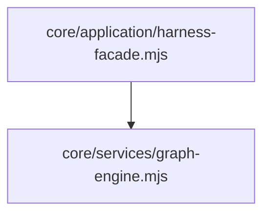

# PROJECT_MAP.md
> Auto-generated repository map (Tiered Top-N Summary, max 200 lines). Total indexed files: **125** | Aggregate Roots: **2**

## 1. Repository Overview
- **Total Indexed Files**: 125
- **Detected Aggregate Roots**: 2
- **Circular Dependencies**: 0
- **God Modules**: 0

## 2. Core Dependency Topology (Top Hubs)

## 3. Module Directory (Tiered Top-N & Aggregate Roots)
- `.harness\scripts\inject-context.mjs` **`[Aggregate Root]`** (refs: 0)
- `core\domain\models.mjs` **`[Aggregate Root]`** (refs: 0)
- `.harness\scripts\analyze-risks.mjs` (refs: 0)
- `.harness\scripts\extract-runtime.mjs` (refs: 0)
- `.harness\scripts\extract-skeleton.mjs` (refs: 0)
- `.harness\scripts\generate-map-md.mjs` (refs: 0)
- `.harness\scripts\handoff-pack.mjs` (refs: 0)
- `.harness\scripts\harness.mjs` (refs: 0)
- `.harness\scripts\lib\cartographer-core.mjs` (refs: 0)
- `.harness\scripts\mcp-server.mjs` (refs: 0)
- `.harness\scripts\sync-map.mjs` (refs: 0)
- `.harness\scripts\test-harness.mjs` (refs: 0)
- `.harness\scripts\verify.mjs` (refs: 0)
- `.verify-state.json` (refs: 0)
- `.vscode\extensions.json` (refs: 0)
- `.vscode\settings.json` (refs: 0)
- `backup-db.js` (refs: 0)
- `core\__tests__\core.test.mjs` (refs: 0)
- `core\adapters\web-ts.adapter.mjs` (refs: 0)
- `core\application\harness-facade.mjs` (refs: 0)
- `core\services\circuit-breaker.mjs` (refs: 0)
- `core\services\graph-engine.mjs` (refs: 0)
- `core\services\sync-engine.mjs` (refs: 0)
- `e2e\example.spec.ts` (refs: 0)
- `e2e\grammar-canvas.spec.ts` (refs: 0)
- `lister.py` (refs: 0)
- `package-lock.json` (refs: 0)

### Folded Long-Tail Directories
- `tests/*` (16 files folded — query via `inspect_impact`)
- `src/rules/*` (10 files folded — query via `inspect_impact`)
- `src/rules/validators/*` (9 files folded — query via `inspect_impact`)
- `src/composables/*` (8 files folded — query via `inspect_impact`)
- `tests/rules/validators/*` (8 files folded — query via `inspect_impact`)
- `src/rules/diagnostics/*` (7 files folded — query via `inspect_impact`)
- `(root)/*` (5 files folded — query via `inspect_impact`)
- `src/utils/*` (5 files folded — query via `inspect_impact`)
- `supabase/migrations/*` (4 files folded — query via `inspect_impact`)
- `tests/rules/diagnostics/*` (4 files folded — query via `inspect_impact`)
- `scripts/*` (3 files folded — query via `inspect_impact`)
- `tests/rules/*` (3 files folded — query via `inspect_impact`)
- `src/*` (2 files folded — query via `inspect_impact`)
- `src/services/*` (2 files folded — query via `inspect_impact`)
- `supabase/functions/deepgram-tts/*` (2 files folded — query via `inspect_impact`)
- `supabase/functions/edge-stt/*` (2 files folded — query via `inspect_impact`)
- `supabase/functions/teacher-action/*` (2 files folded — query via `inspect_impact`)
- `src/data/*` (1 files folded — query via `inspect_impact`)
- `src/domain/*` (1 files folded — query via `inspect_impact`)
- `src/infrastructure/*` (1 files folded — query via `inspect_impact`)
- `supabase/.temp/*` (1 files folded — query via `inspect_impact`)
- `supabase/functions/lt-proxy/*` (1 files folded — query via `inspect_impact`)
- `tests/utils/*` (1 files folded — query via `inspect_impact`)

## 4. Verification & Risk Gates
- Run `node .harness/scripts/harness.mjs inspect_impact --files=<path> --json` before editing.
- Run `npm run verify` to enforce static ESM hygiene and `>=80%` core coverage.

## 6. Runtime Context (DB & API)
**DB Schemas**: Table: `questions` (client:backup-db.js) | Table: `classroom_state` (client:src/composables/useClassroomSync.ts) | Table: `learning_logs` (client:src/services/CloudDatabase.ts) | Table: `diagnosis_cache` (supabase/migrations/20261103000000_diagnosis_cache.sql)
**API Endpoints**:
- **INVOKE_FN** `/functions/v1/teacher-action` (src/composables/useClassroomSync.ts)
- **EDGE_FN** `/functions/v1/deepgram-tts` (supabase/functions/deepgram-tts/index.ts)
- **EDGE_FN** `/functions/v1/edge-stt` (supabase/functions/edge-stt/index.ts)
- **FETCH** `https://api.deepgram.com/v1/listen?model=nova-2&language=en-US&smart_format=true` (supabase/functions/edge-stt/index.ts)
- **EDGE_FN** `/functions/v1/lt-proxy` (supabase/functions/lt-proxy/index.ts)
- **EDGE_FN** `/functions/v1/teacher-action` (supabase/functions/teacher-action/index.ts)

## 7. Ubiquitous Language Glossary
| Business Domain Term | Technical Module | Aggregate Root |
| :--- | :--- | :--- |
| Inject Context | `.harness\scripts\inject-context.mjs` | `[Aggregate Root]` |
| Models | `core\domain\models.mjs` | `[Aggregate Root]` |
| Default Exclude | `node_modules\@istanbuljs\schema\default-exclude.js` | `[Aggregate Root]` |
| Default Extension | `node_modules\@istanbuljs\schema\default-extension.js` | `[Aggregate Root]` |
| Index | `node_modules\@istanbuljs\schema\index.js` | `[Aggregate Root]` |
| Package | `node_modules\@istanbuljs\schema\package.json` | `[Aggregate Root]` |
| Context D | `node_modules\@vue\language-core\lib\codegen\script\context.d.ts` | `[Aggregate Root]` |
| Context | `node_modules\@vue\language-core\lib\codegen\script\context.js` | `[Aggregate Root]` |
| Context D | `node_modules\@vue\language-core\lib\codegen\template\context.d.ts` | `[Aggregate Root]` |
| Context | `node_modules\@vue\language-core\lib\codegen\template\context.js` | `[Aggregate Root]` |
| Contractions | `node_modules\compromise\src\1-one\contraction-one\model\contractions.js` | `[Aggregate Root]` |
| Index | `node_modules\compromise\src\1-one\contraction-one\model\index.js` | `[Aggregate Root]` |
| Number Suffix | `node_modules\compromise\src\1-one\contraction-one\model\number-suffix.js` | `[Aggregate Root]` |
| Honorifics | `node_modules\compromise\src\1-one\tokenize\model\abbreviations\honorifics.js` | `[Aggregate Root]` |
| Misc | `node_modules\compromise\src\1-one\tokenize\model\abbreviations\misc.js` | `[Aggregate Root]` |
| Months | `node_modules\compromise\src\1-one\tokenize\model\abbreviations\months.js` | `[Aggregate Root]` |
| Nouns | `node_modules\compromise\src\1-one\tokenize\model\abbreviations\nouns.js` | `[Aggregate Root]` |
| Organizations | `node_modules\compromise\src\1-one\tokenize\model\abbreviations\organizations.js` | `[Aggregate Root]` |
| Places | `node_modules\compromise\src\1-one\tokenize\model\abbreviations\places.js` | `[Aggregate Root]` |
| Units | `node_modules\compromise\src\1-one\tokenize\model\abbreviations\units.js` | `[Aggregate Root]` |
| Aliases | `node_modules\compromise\src\1-one\tokenize\model\aliases.js` | `[Aggregate Root]` |
| Index | `node_modules\compromise\src\1-one\tokenize\model\index.js` | `[Aggregate Root]` |
| Lexicon | `node_modules\compromise\src\1-one\tokenize\model\lexicon.js` | `[Aggregate Root]` |
| Prefixes | `node_modules\compromise\src\1-one\tokenize\model\prefixes.js` | `[Aggregate Root]` |
| Punctuation | `node_modules\compromise\src\1-one\tokenize\model\punctuation.js` | `[Aggregate Root]` |
| Suffixes | `node_modules\compromise\src\1-one\tokenize\model\suffixes.js` | `[Aggregate Root]` |
| Unicode | `node_modules\compromise\src\1-one\tokenize\model\unicode.js` | `[Aggregate Root]` |
| Lib | `node_modules\compromise\src\2-two\left-right\model\_lib.js` | `[Aggregate Root]` |
| By Switch | `node_modules\compromise\src\2-two\left-right\model\by-switch.js` | `[Aggregate Root]` |
| By Tag | `node_modules\compromise\src\2-two\left-right\model\by-tag.js` | `[Aggregate Root]` |
| By Word | `node_modules\compromise\src\2-two\left-right\model\by-word.js` | `[Aggregate Root]` |
| Index | `node_modules\compromise\src\2-two\left-right\model\index.js` | `[Aggregate Root]` |
| Lib | `node_modules\compromise\src\2-two\postTagger\model\_lib.js` | `[Aggregate Root]` |
| Expand Rules | `node_modules\compromise\src\2-two\postTagger\model\expand-rules.js` | `[Aggregate Root]` |
| Hanging Adverbs | `node_modules\compromise\src\2-two\postTagger\model\hanging-adverbs.js` | `[Aggregate Root]` |
