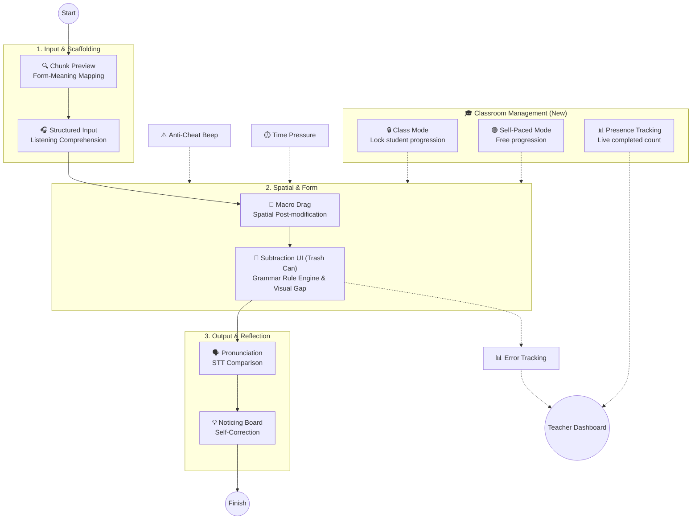
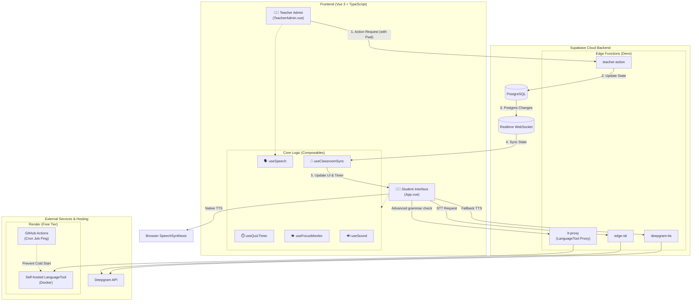
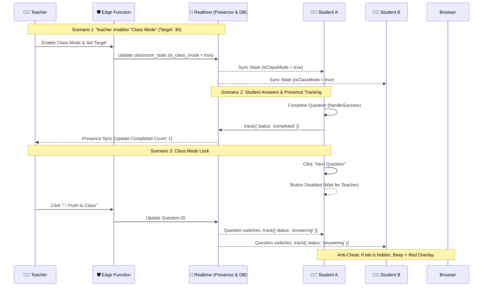
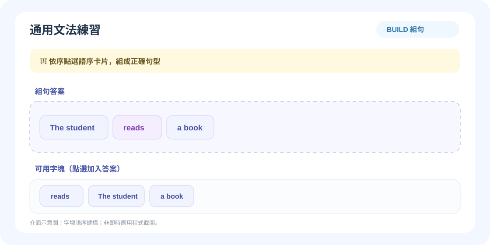
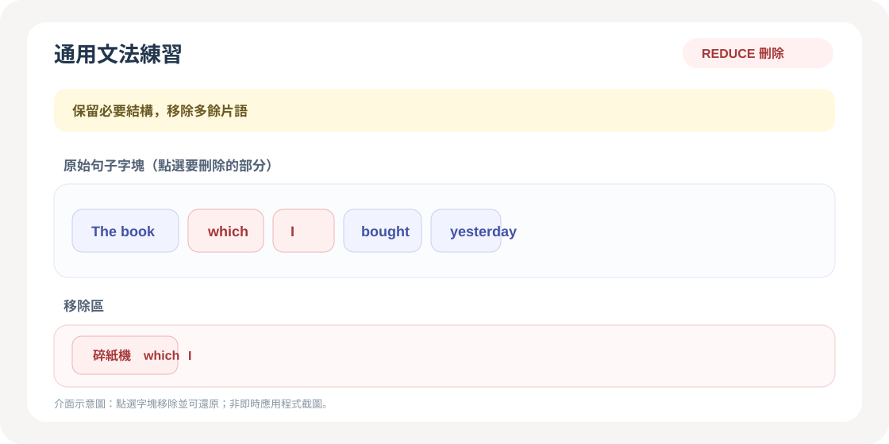
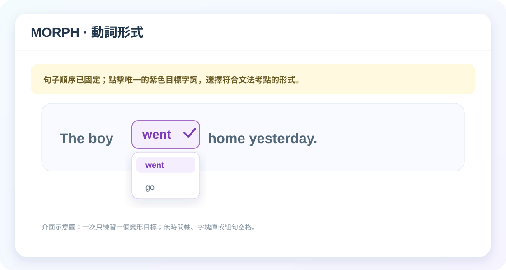
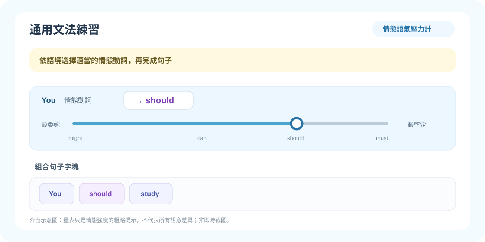

# 🕵️ SyntaxHunt (文法出題診斷系統)

**[English](README.md) | [繁體中文](README.zh-TW.md)**

An interactive, cognitive-pipeline-driven English grammar learning tool designed for K-12 education.

Built with **Vue 3, TypeScript, Vite, and Supabase**, this application takes a pedagogical approach to teaching **Post-modifiers (Relative Clauses & Prepositional Phrases)**, specifically targeting the common L1 interference (Chinese pre-modifiers vs. English post-modifiers), structural misconceptions (e.g., redundant pronouns like `who she`), and **Phrase Chunking**. Teachers can also author general grammar questions in `BUILD`, `REDUCE`, or `MORPH` mode; answers are checked by a local rule engine first, with self-hosted LanguageTool providing additional diagnostics when local rules cannot classify an incorrect answer.

The sample lesson is designed for a 45-minute class for **Grade 9 (115 iE5, Unit 5: *The Man Who Shook Hands with Me Is My Favorite Star*)**, covering Grammar Focus 1 (prepositional phrases), Grammar Focus 2 (subject relative clauses with *who / which / that*), and the p.107 Read activity.

---

## 🧠 The Cognitive Pipeline (Pedagogy-Driven Design)

This app is built upon Second Language Acquisition (SLA) theories. The sample lesson guides students through an input-to-output sequence:



1. **Chunk Phrase Quiz**: Establishes Form-Meaning Mapping.
2. **Macro Drag & Contrast Puzzle**: Builds a spatial sense of English post-modification (no text labels to prevent answer leaking).
3. **Standard & Reduce**: Features Input Processing, Focus on Form using a unique **"Trash Can" subtraction mechanic**, Prosody Output, and Consciousness-Raising.
4. **General Grammar Canvas**: A separate teacher-authored activity supports `BUILD` (assemble chunks), `REDUCE` (remove redundant chunks), and `MORPH` (change an inflected chunk).

---

## 🏗️ System Architecture

The system is highly decoupled, using **Supabase** as the central hub to connect the Vue 3 frontend, teacher admin, and external AI speech services.



---

## 🎙️ Hybrid Speech Architecture

To support devices with different voice-pack availability, speech playback uses native English voices when available and can route to Deepgram through a Supabase Edge Function.

- **TTS**: Uses a preferred native English voice when available; otherwise it requests **Deepgram TTS** through the `deepgram-tts` Edge Function. A failed Deepgram request does not automatically fall back to a native voice.
- **STT**: Records audio with the browser's `MediaRecorder` and sends it to **Deepgram STT** through the `edge-stt` Edge Function. If transcription fails, students can play back their recording and continue; there is no automatic browser speech-recognition fallback.

---

## ⚡ Real-time Classroom Flow (Master-Slave & Anti-Cheat)

This sequence diagram illustrates the **Class Mode Lock**, **Presence Tracking**, and **Anti-Cheat** mechanisms.



---

## ✨ Key Features

### For Students
- **Trash Can Subtraction UI (Reduce Mode)**: Students see the complete sentence and physically discard redundant words into a trash can, witnessing the sentence shrink.
- **Class Mode Lock**: When the teacher enables Class Mode, the "Next" button is disabled. Students must wait for the teacher's push command.
- **Phrase Chunking Visuals**: Multi-word units appear as distinct blue tiles.
- **Speech Playback**: Hear the sentence through a native English voice or Deepgram TTS.
- **Pronunciation Practice**: Record your voice for Deepgram STT transcription and word-by-word comparison.

### For Teachers (Teacher Admin)
- **Presence Dashboard**: Input the target student count. Watch the live progress bar (`completed / target`) update in real-time as students finish.
- **Class Mode Toggle**: Lock the entire class's progression instantly. Perfect for synchronized classroom teaching.
- **Funnel-Based Authoring**: Wrap phrases in `[ ]`. Visualizes "Kept" and "Discarded" words. If a verb needs to become a preposition, edit the green box.
- **Semantic Control (Person vs. Thing)**: A dedicated toggle in the authoring form allows teachers to explicitly define whether the antecedent is a "Person" or a "Thing". This eliminates fragile string-matching heuristics and ensures the local rule engine accurately diagnoses `who` vs. `which` errors.
- **Local Deterministic Chunking**: Uses `compromise.js` and an irregular-verb JSON table to automatically generate interactive chunks and morphology options without calling an LLM.
- **Visual Question Flow and Unit Folders**: Open the full-screen node canvas to reorder questions by dragging nodes or using `Alt` + `←` / `→`. Create unit folders, then drag a question into a folder or select multiple questions and move them together. Unselected questions remain in the Unclassified inbox. Use **Copy to** to reuse a question in another unit without changing the original, or create a new question directly in the selected unit. Changes are saved to local storage and the cloud immediately; **Finish prep** saves the final question order.
- **Master Remote Control**: Push questions, force-reset timers, and add time (`+30s`) instantly.

### Using general grammar questions

1. Open **Teacher Admin** and select **General Grammar** in the question editor.
2. Choose a curriculum chapter and a specific grammar topic. The system recommends one interaction mode, learning focus, and rationale; the mode is not freely switchable.
3. Enter the source sentence and the exact target answer. For `REDUCE`, enter the complete sentence as the source and the reduced sentence as the answer.
4. Click **Local chunking** or split the sentence manually. Bracket a multi-word chunk in the source, e.g. `[in a blue uniform]`. Review the generated chips and edit the chunks before using them.
5. For a `MORPH` topic, mark exactly one changeable chunk and provide its comma-separated forms (e.g. `go, goes, went`). Students see the fixed sentence and click that word to choose a form. Chunking uses compromise.js and an irregular-verb JSON table; add or correct forms manually when needed.
6. Click **Add to question bank**. Click **Send to class** on that question to make it active, or click **Finish prep** to save the bank and close the editor (reopen Teacher Admin to push it later). `BUILD` shuffles assembly tiles, `PRAGMATIC_HP` shuffles the phrase bank, and `MATRIX_GATE` shuffles only its candidate cards. `MORPH` and `GRAVITY_SWITCH` keep the sentence fixed; `REDUCE` preserves the source order so students focus on deletion and simplification.

> **Teacher access note:** The frontend demo uses the fixed password `admin123` and sends that same value to `teacher-action`. The Edge Function defaults to `admin123` when `TEACHER_PASSWORD` is unset; setting that secret to a different value will break remote teacher actions until the frontend is updated too. This is not secure authentication—do not expose the demo as a public or production teacher console.

## 📷 UI Screenshots

These are screenshots of the running Vue UI with representative lesson data. The grammar canvases are captured from their actual components; the teacher screens are captured from the application.

| Student lesson | Teacher sign-in |
| :---: | :---: |
|  |  |

| Teacher question editor | Question flow and unit folders | Teacher analytics |
| :---: | :---: | :---: |
|  |  |  |

| `BUILD` — shuffled sentence assembly | `REDUCE` — preserve source order and remove chunks |
| :---: | :---: |
|  |  |

| `MORPH` — fixed sentence and form selection | `GRAVITY_SWITCH` — fixed conditional sentence |
| :---: | :---: |
|  |  |

| `MATRIX_GATE` — shuffled candidate cards | `PRAGMATIC_HP` — shuffled phrase bank |
| :---: | :---: |
|  |  |

---

## 🔬 Grammar Rule Engine & Diagnosis

`src/rules/grammarRules.ts` runs registered validators for duplicate pronouns after a relative pronoun, antecedent-based subject-verb agreement, *who / which* choice, `REDUCE` leftovers, common subject-verb agreement, `a/an` choice, and `MORPH` forms. Concept-specific validators live in `src/rules/validators/` and are discovered by the registry. If those rules do not provide a definite diagnosis, an LCS token alignment compares the student answer with the key to classify omissions, additions, substitutions, or reordering. These checks are rule-based heuristics, not a general-purpose English parser; verb agreement coverage depends on the local verb table.

| Code family | Examples | Local diagnosis |
| :--- | :--- | :--- |
| `M:*` | `M:VERB`, `M:AUX`, `M:DET`, `M:PREP`, `M:CONJ` | A required word or conjunction is missing. |
| `R:*` | `R:VERB:SVA`, `R:VERB:TENSE`, `R:VERB:FORM`, `R:VERB:MOOD`, `R:RELATIVE`, `R:PREP`, `R:DET`, `R:NOUN:NUM`, `R:CONJ` | A verb form, relative pronoun, preposition, determiner, noun number, or conjunction is incorrect. |
| `U:*` | `U:PRON`, `U:VERB`, `U:RELATIVE`, `U:CONJ` | An unnecessary pronoun, verb, relative pronoun, or conjunction remains. |
| `O:*` | `O:WRONG_ORDER`, `O:INVERSION` | Words are out of order, including incorrect auxiliary placement in inversion. |
| `UNKNOWN_ERROR` | — | Local rules cannot assign a specific error; LanguageTool is asked for additional suggestions. |

Local diagnoses retain their K-12 error codes and SST category (`Omission`, `Addition`, `Misformation`, or `Misordering`). If local rules cannot classify an incorrect answer, the app requests LanguageTool through the `lt-proxy` Supabase Edge Function. 

To ensure accurate diagnostics, the system performs **Context Stitching**: it reconstructs the full sentence by concatenating the `contextCloze` prefix, the student's assembled chunks, and the suffix before sending it to LanguageTool. When LanguageTool returns errors, the system performs **Offset Mapping**: it subtracts the prefix length from the native character offset and maps it back to the visible chunks for precise UI highlighting. 

An 8-second timeout (accommodating Render's cold starts) or service failure displays a neutral notice and lets the student skip to the next question. In `BUILD` and `MORPH`, students can also check a partial answer before filling every slot.

Teacher-authored general grammar questions select a curriculum chapter and a specific topic. Each topic supplies a recommended interaction, learning focus, and rationale. `BUILD` randomizes the authored word bank without changing the saved answer; `MORPH` and `GRAVITY_SWITCH` keep sentence order fixed; `REDUCE` starts from the original sentence order; `MATRIX_GATE` randomizes its candidate cards only; and `PRAGMATIC_HP` randomizes its phrase bank. The topic catalog maps five sentence patterns to BUILD, tense/comparison/gerund/passive forms to MORPH, participle and relative-clause simplification plus pronoun substitution to REDUCE, special and sense/causative verb contrasts to MATRIX_GATE, modal/emotion contexts to PRAGMATIC_HP, and unreal conditionals to GRAVITY_SWITCH. Morphology topics show the fixed sentence and let students click the configured target word, without a tile bank or sentence slots. `autoChunk(sentence, concept)` uses compromise.js for deterministic tokenization and verb parsing, checks the irregular-verb table first, and preserves bracketed phrases as explicit chunks. It does not call an LLM. MORPH options are stored as strings with `current_index` identifying the initial selected form, while legacy `morph_options` remains supported. Questions without a saved curriculum topic keep their existing settings and canvas.

### How the Rule Registry connects authoring, gameplay, and diagnosis

The registry is the **local diagnosis plugin point**, not the question authoring UI router:

1. **Authoring:** In Teacher Admin, the teacher selects a curriculum chapter and a specific topic. The topic determines the recommended interaction, learning focus, and rationale; the teacher enters the sentence and answer, then uses local `autoChunk` (or edits the chunks and morphology options). `autoChunk` does not consult the Rule Registry. For a `MORPH` topic, exactly one chunk can be configured as the transformation target.
2. **Gameplay UI:** `GrammarCanvas.vue` selects a canvas from the saved topic, `concept`, and `ui_mode`; it does not look up registered rules. Curriculum topics supply their recommended mode, while legacy questions without a saved topic retain their prior settings. The current routing is:

   | Question setting | Student interaction |
   | :--- | :--- |
   | `MODAL_VERB` | Modal-strength gauge |
   | `REDUCE` | Shredder-style reduction |
   | `MORPH` with a saved curriculum topic, or a legacy tense/agreement/subjunctive/conditional concept | Fixed sentence with click-to-change word forms |
   | `BUILD` | Magnetic sentence slots |
   | No concept or an unmatched combination | Legacy canvas |

   The SVG gallery below shows **illustrative UI mockups**. For live component screenshots and the student/teacher screens, see [UI Screenshots](#-ui-screenshots). The student's actual canvas is routed as above; tiles are selected by clicking rather than dragging, and retained `REDUCE` tiles can be reordered with their arrow controls. A `MORPH` topic keeps the sentence fixed and exposes one configured target word, rather than asking students to also assemble sentence tiles.

   | `BUILD` — assemble sentence chunks | `REDUCE` — remove unnecessary chunks |
   | :---: | :---: |
   |  |  |

   | `MORPH` — select a tense or verb form | `MODAL_VERB` — choose a modal strength |
   | :---: | :---: |
   |  |  |
3. **Diagnosis:** After submission, `diagnoseGrammar` runs general validators plus validators registered for that question's concept. `grammarRules.ts` eagerly loads `src/rules/validators/*.ts`; each plugin calls `registerGrammarRule` with an ID, validator, and optional concept list. For example, conjunction rules target clause concepts, inversion targets question/inversion concepts, and modal-form checks target `MODAL_VERB`. A definite local signal drives the existing misconception feedback/logging; if local rules cannot classify the incorrect answer, LanguageTool is called through the Supabase `lt-proxy` Edge Function and its native result is retained.

Therefore, adding a validator changes local diagnosis only. It does not automatically add a teacher form field or a new visual interaction; those require updates to the concept/type list, authoring controls, and/or canvas routing as appropriate. For a new validator, add a file under `src/rules/validators/` and register it; keep the ID unique.

### Does the current UI cover `Grammar_Scope.md`?

The authoring form exposes every concept listed in the scope, but that does **not** mean every grammatical distinction is modeled or diagnosed exhaustively. Current coverage is:

| Scope topic | Current interaction | Coverage and limitation |
| :--- | :--- | :--- |
| Sentence units, S/V/O/C, five sentence patterns | `BUILD` | Can assemble a keyed sentence; it does not label grammatical roles or model each pattern as a distinct task. |
| Subject-verb agreement; tense and aspect | `MORPH` or `BUILD` | Supports teacher-configured alternatives and exact-answer checking. A `MORPH` topic focuses on one target word in a fixed sentence; this does not model all tense/aspect combinations. |
| Questions and inversion | `BUILD` | Can assemble a question/inverted sentence. Local inversion diagnosis is heuristic, not a general question parser. |
| Connectors; noun, adjective, and adverb clauses | `BUILD` / `REDUCE` | Can assemble or reduce teacher-authored chunks. Deterministic tokenization does not identify clause boundaries or grammatical roles; teachers can bracket phrases and edit the generated chunks. |
| Subjunctive mood and conditionals | `MORPH` / `BUILD` | Can practice supplied forms and sentence order, but there is no dedicated two-clause conditional interaction; local mood diagnosis covers only narrow patterns. |
| Modal verbs (an additional concept beyond the current scope list) | Modal-strength gauge plus `BUILD` | The gauge presents an approximate strength order; it does not capture all context-dependent modal meanings. Local checking focuses on the base form after a modal. |

**Recommendation:** A new top-level game mode is not necessary to start teaching these topics: `BUILD`, `REDUCE`, and `MORPH` already provide the basic assemble/remove/change-form actions. However, the current UI is not enough to claim complete K–12 grammar coverage. Prioritize improvements within those modes—explicit S/V/O/C and clause scaffolds, richer tense/aspect choices, and paired-clause conditional prompts—along with broader validators. Add a separate game type only if those concepts need interaction that cannot be expressed as chunk assembly, removal, or form selection.

### Implementation and rollout status (2026-11-05)

The adaptive canvas, legacy adapter, compromise.js chunker, local rule engine, and LanguageTool diagnosis path are implemented. For an incorrect answer without a definite local diagnosis, the browser calls the Supabase `lt-proxy` Edge Function, which forwards the text to the configured Cloud Run LanguageTool endpoint and returns native matches for display and logging. The proxy handles browser `POST` preflight requests and returns an explicit configuration error if `LANGUAGETOOL_URL` is missing. Legacy questions are adapted when loaded into the canvas rather than rewritten in the `questions` table.

After the teacher password is accepted, the app automatically sends a short, valid sentence through the same LanguageTool proxy to warm the service. This request does not create a learning log and does not block teacher access if it fails.

The code path is integrated, but this repository cannot confirm whether the hosted Supabase project and Cloud Run service are configured and reachable. To enable the deployed path, apply the migrations, set `LANGUAGETOOL_URL` to the actual Cloud Run LanguageTool `/v2/check` endpoint, and deploy the proxy:

```bash
npx supabase db push
npx supabase secrets set LANGUAGETOOL_URL=https://lt-proxy-xxx.run.app/v2/check
npx supabase functions deploy lt-proxy
```

The LanguageTool migration adds `source`, `category`, and `rule_id` to `learning_logs` and removes the obsolete diagnosis cache. The frontend calls only the Supabase proxy; it does not connect to Cloud Run directly. Replace the example `lt-proxy-xxx.run.app` host above with the real endpoint.

---

## 🛠️ Tech Stack & Engineering

- **Frontend**: Vue 3 (Composition API) + Vite + TypeScript
- **Local NLP**: compromise.js + `english-verbs-irregular`
- **Backend & DB**: Supabase (PostgreSQL, Edge Functions, Realtime Presence)
- **Speech**: Native `SpeechSynthesis` for available TTS voices; Deepgram TTS/STT via Edge Functions
- **Drag & Drop**: Native Pointer Events and the browser's HTML Drag and Drop API

---

## 🚀 Getting Started

### Environment Setup
Create a `.env.local` file:
```env
VITE_SUPABASE_URL=your_supabase_project_url
VITE_SUPABASE_ANON_KEY=your_supabase_anon_key
```

### Supabase Setup
1. Create the application's baseline tables before applying migrations; this repository does not include migrations that create these tables:
   - `questions`: `id`, `data`, and `created_at`.
   - `learning_logs`: `id`, `student_name`, `question_id`, `error_code`, and `created_at`. The migrations add diagnosis-related columns.
   - `classroom_state`: `id`, `current_question_id`, `timer_end_time`, `is_class_mode`, `target_count`, and `updated_at`. Add the row with `id = 'current_state'` and enable Realtime for this table.

   Configure the required table access policies for the frontend's Supabase anon key. The frontend directly reads/writes the question bank and learning logs; teacher state changes go through the `teacher-action` Edge Function.
2. Apply the database migrations and deploy the Edge Functions:
   ```bash
   npx supabase db push
   npx supabase functions deploy deepgram-tts
   npx supabase functions deploy edge-stt
   npx supabase functions deploy teacher-action
   npx supabase functions deploy lt-proxy
   ```
3. Set the service secrets:
   ```bash
   npx supabase secrets set DEEPGRAM_API_KEY=your_deepgram_key
   npx supabase secrets set LANGUAGETOOL_URL=https://your-render-url.onrender.com/v2/check
   ```
  `LANGUAGETOOL_URL` is required for LanguageTool diagnosis. Leave `TEACHER_PASSWORD` unset for the demo's fixed `admin123` password.

### Self-Hosting LanguageTool on Render

To maintain a zero-cost architecture, LanguageTool is deployed on Render's free tier.

1. Create a new Web Service on Render and select Deploy an existing image. Use the image docker.io/erikvl87/languagetool:latest.

2. Set the following Environment Variables to prevent Out-Of-Memory (OOM) crashes within Render's 512MB limit:

- `Java_Xms=128m`

- `Java_Xmx=320m`

- `JAVA_TOOL_OPTIONS=-XX:MaxRAMPercentage=60.0 -XX:+UseSerialGC -XX:MaxMetaspaceSize=128m`

3. Deploy the service and copy the Render URL. Set it in your Supabase secrets (as shown above).

4. Keep-Alive Mechanism: Render's free tier sleeps after 15 minutes of inactivity. The repository includes a GitHub Actions workflow (.`github/workflows/keep-alive.yml`) that automatically pings the Render endpoint every 10 minutes to prevent cold-start delays during classroom sessions.

### Development & Testing
```bash
npm install
npm run dev
npm test
```