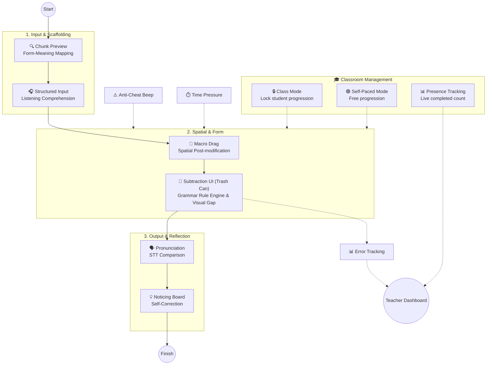
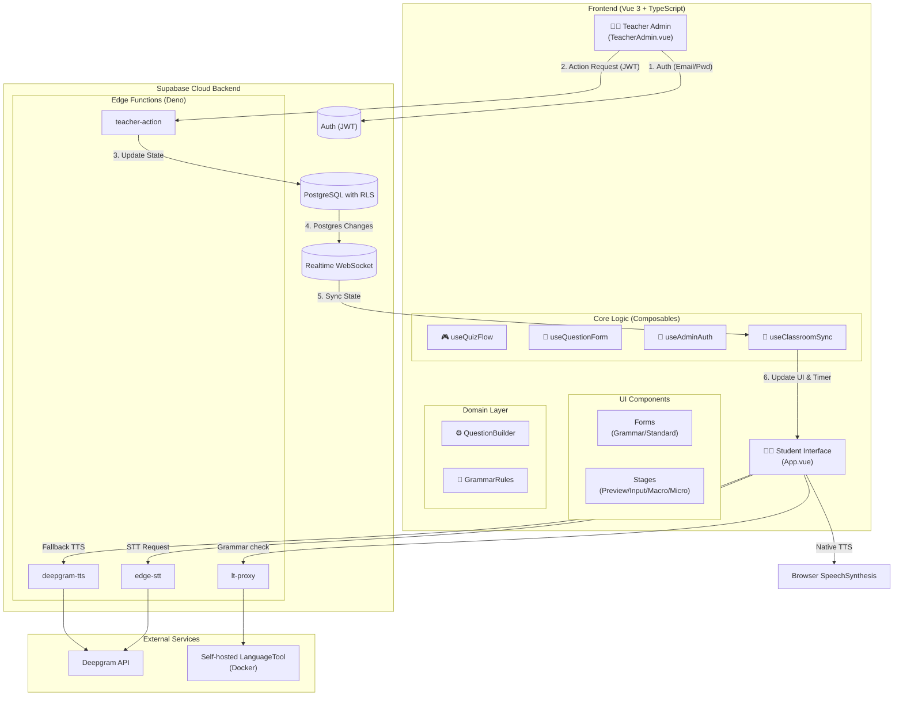
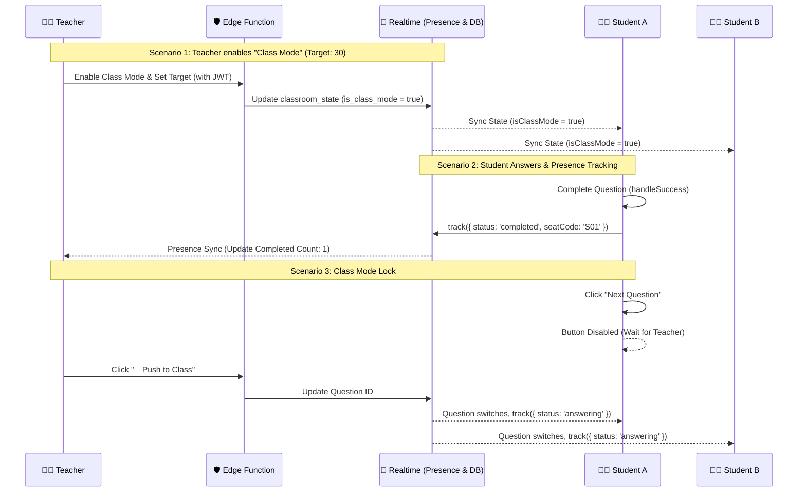

# 🕵️ SyntaxHunt (Grammar Diagnostic System)

**[English](README.md) | [繁體中文](README.zh-TW.md)**

An interactive, cognitive-pipeline-driven English grammar learning tool designed for K-12 education.

Built with **Vue 3, TypeScript, Vite, and Supabase**, this application takes a pedagogical approach to teaching **Post-modifiers (Relative Clauses & Prepositional Phrases)**, specifically targeting the common L1 interference (Chinese pre-modifiers vs. English post-modifiers), structural misconceptions (e.g., redundant pronouns like `who she`), and **Phrase Chunking**. Teachers can also author general grammar questions in `BUILD`, `REDUCE`, or `MORPH` mode; answers are checked by a local rule engine first, with self-hosted LanguageTool providing additional diagnostics when local rules cannot classify an incorrect answer.

The sample lesson is designed for a 45-minute class for **Grade 9 (115 iE5, Unit 5: *The Man Who Shook Hands with Me Is My Favorite Star*)**, covering Grammar Focus 1 (prepositional phrases), Grammar Focus 2 (subject relative clauses with *who / which / that*), and the p.107 Read activity.

---

## 🧠 The Cognitive Pipeline (Pedagogy-Driven Design)

This app is built upon Second Language Acquisition (SLA) theories. The sample lesson guides students through an input-to-output sequence:



1. **Chunk Phrase Quiz**: Establishes Form-Meaning Mapping.
2. **Macro Drag & Contrast Puzzle**: Builds a spatial sense of English post-modification (no text labels to prevent answer leaking).
3. **Standard & Reduce**: Features Input Processing, Focus on Form using a unique **"Trash Can" subtraction mechanic**, Prosody Output, and Consciousness-Raising.
4. **General Grammar Canvas**: A separate teacher-authored activity supports `BUILD` (assemble chunks), `REDUCE` (remove redundant chunks), and `MORPH` (change an inflected chunk).

---

## 🏗️ System Architecture

The system is highly decoupled, using **Supabase** as the central hub to connect the Vue 3 frontend, teacher admin, and external AI speech services. The codebase follows **Domain-Driven Design (DDD)** and **Clean Architecture** principles.



---

## 🔒 Multi-Tenancy & Security (Teacher Isolation)

This application strictly implements multi-tenancy to ensure teachers can only see and modify their own questions and classroom states.

- **Supabase Auth**: Teachers log in using Email and Password via `supabase.auth.signInWithPassword`.
- **Database Schema**: The `questions`, `learning_logs`, and `classroom_state` tables all include a `teacher_id UUID REFERENCES auth.users(id) DEFAULT auth.uid()` column.
- **Row Level Security (RLS)**:
  - **Teachers**: Can only `SELECT`, `INSERT`, `UPDATE`, and `DELETE` rows where `auth.uid() = teacher_id`.
  - **Students**: Do not access the `questions` table directly. They load the question bank from `localStorage` or default questions. They connect to the teacher's Realtime channel via `room_code`.
- **Seat Codes**: Students are assigned a random seat code (`S01`–`S30`) stored in `sessionStorage`, which is sent via `trackPresence(seatCode)` for live classroom tracking.
- **Realtime Isolation**: Channels are strictly named `classroom_sync_${teacherId}` to prevent cross-tenant data leaks.

---

## ⚡ Real-time Classroom Flow (Master-Slave & Anti-Cheat)

This sequence diagram illustrates the **Class Mode Lock**, **Presence Tracking**, and **Anti-Cheat** mechanisms.



---

## ✨ Key Features

### For Students
- **Trash Can Subtraction UI (Reduce Mode)**: Students see the complete sentence and physically discard redundant words into a trash can.
- **Class Mode Lock**: When the teacher enables Class Mode, the "Next" button is disabled. Students must wait for the teacher's push command.
- **Phrase Chunking Visuals**: Multi-word units appear as distinct blue tiles.
- **Speech Playback**: Hear the sentence through a native English voice or Deepgram TTS.
- **Pronunciation Practice**: Record your voice for Deepgram STT transcription and word-by-word comparison.

### For Teachers (Teacher Admin)
- **Presence Dashboard**: Input the target student count. Watch the live progress bar update in real-time. Seat codes are displayed in the grid.
- **Class Mode Toggle**: Lock the entire class's progression instantly.
- **Funnel-Based Authoring**: Wrap phrases in `[ ]`. Visualizes "Kept" and "Discarded" words.
- **Semantic Control (Person vs. Thing)**: Explicitly define whether the antecedent is a "Person" or a "Thing" to ensure accurate `who` vs. `which` diagnostics.
- **Local Deterministic Chunking**: Uses `compromise.js` and an irregular-verb JSON table to automatically generate interactive chunks.
- **Visual Question Flow**: Open the full-screen node canvas to reorder questions by dragging nodes.
- **Master Remote Control**: Push questions, force-reset timers, and add time (`+30s`) instantly.
- **QR Code & Room Code Sharing**: Instantly generate a projector-friendly QR Code. Students can scan it to automatically join the teacher's specific classroom channel without typing.

### Using general grammar questions

1. Open **Teacher Admin** and select **General Grammar** in the question editor.
2. Choose a curriculum chapter and a specific grammar topic.
3. Enter the source sentence and the exact target answer.
4. Click **Local chunking** or split the sentence manually.
5. For a `MORPH` topic, mark exactly one changeable chunk and provide its comma-separated forms.
6. Click **Add to question bank** and **Send to class** to make it active.

> **Teacher Access Note:** Teacher sign-in uses Supabase Auth (`signInWithPassword`). You can now **register a new teacher account directly from the login modal** by clicking "Sign up". Alternatively, you can create accounts manually in the Supabase Dashboard.

---

## 🛠️ Tech Stack & Engineering

- **Frontend**: Vue 3 (Composition API) + Vite + TypeScript
- **State Management**: Vue Composables (`useQuizFlow`, `useQuestionForm`, `useClassroomSync`)
- **Local NLP**: compromise.js + `english-verbs-irregular`
- **Diagnostic Engine**: Local Rule Registry + LCS algorithm + LanguageTool (Deep Semantic Check)
- **Backend & DB**: Supabase (PostgreSQL, Edge Functions, Realtime Presence, Auth, RLS)
- **Infrastructure**: Render (Docker / LanguageTool) + GitHub Actions (Keep-Alive)
- **Speech (TTS & STT)**: Native `SpeechSynthesis` / Deepgram via Edge Functions
- **QR Code Generation**: `qrcode.vue`

---

## 🚀 Getting Started

### Environment Setup
Create a `.env.local` file:
```env
VITE_SUPABASE_URL=your_supabase_project_url
VITE_SUPABASE_ANON_KEY=your_supabase_anon_key
```

### Supabase Setup
1. Create the baseline tables (`questions`, `learning_logs`, `classroom_state`).
2. Apply the latest migrations (which add `teacher_id`, `seat_code`, and enable RLS):
   ```bash
   npx supabase db push
   ```
3. Deploy the Edge Functions:
   ```bash
   npx supabase functions deploy deepgram-tts
   npx supabase functions deploy edge-stt
   npx supabase functions deploy teacher-action
   npx supabase functions deploy lt-proxy
   ```
4. Create a Teacher account in **Supabase Dashboard -> Authentication -> Users**.

### Development & Testing
```bash
npm install
npm run dev
npm test
```