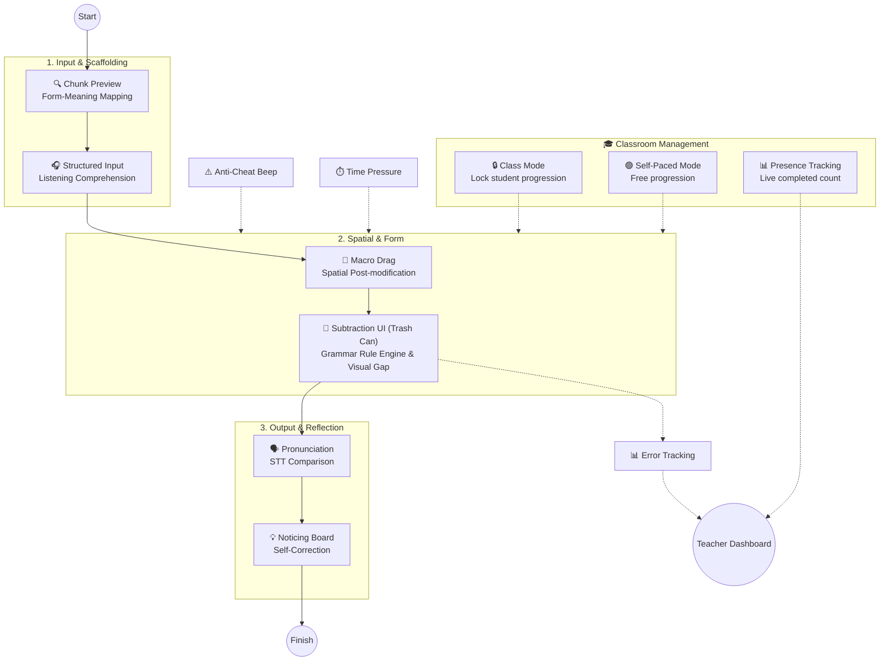
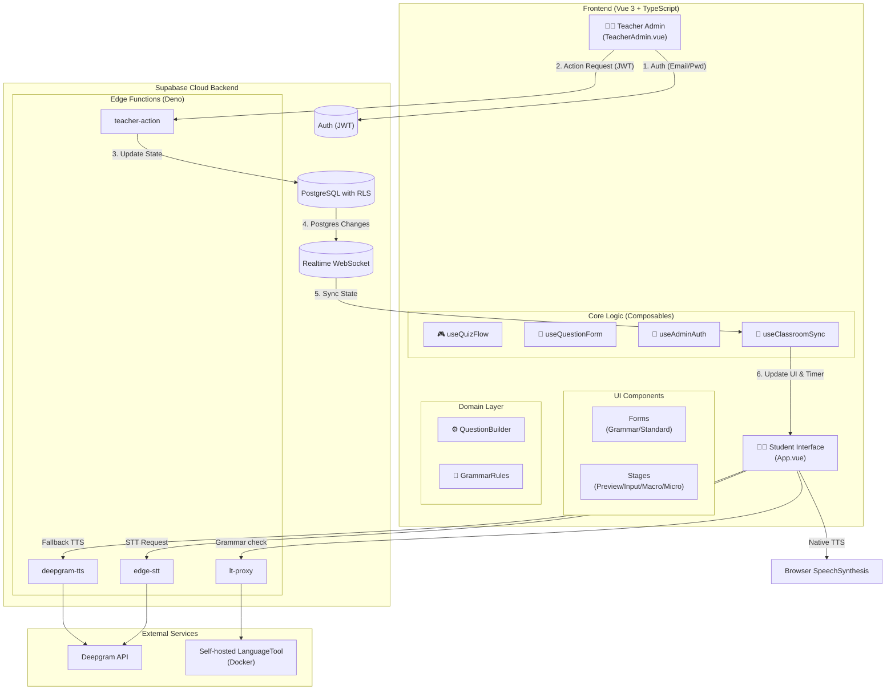
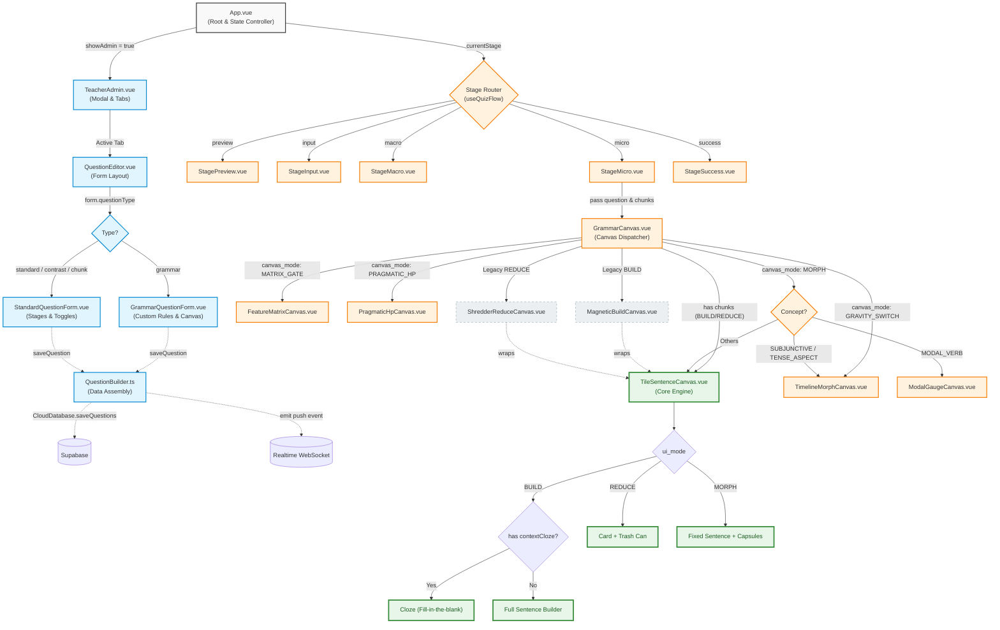
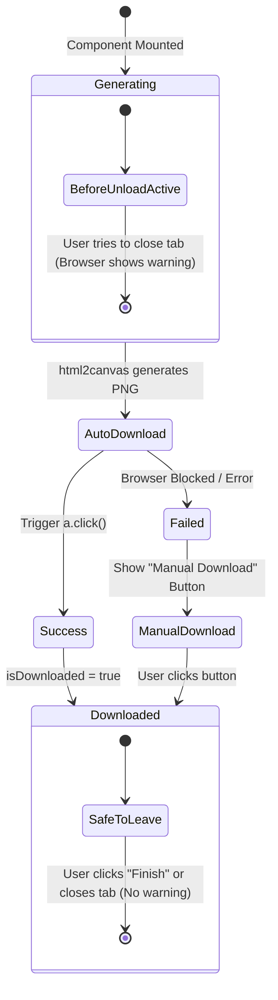
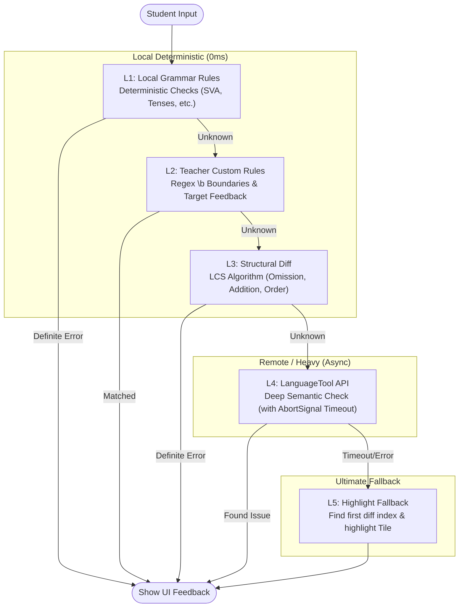
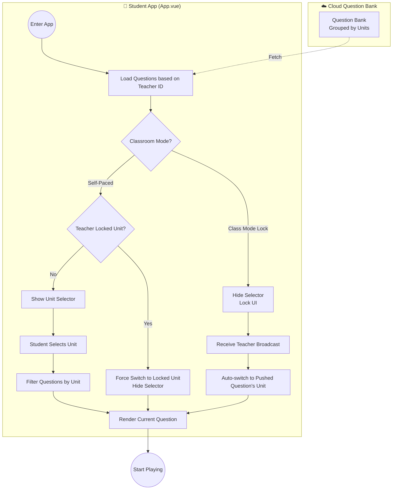
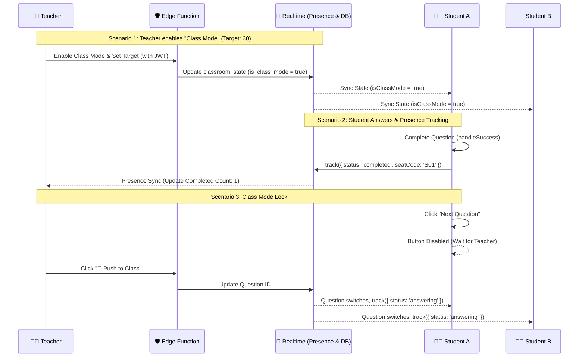

# 🕵️ SyntaxHunt (Grammar Diagnostic System)

**[English](README.md) | [繁體中文](README.zh-TW.md)**

An interactive, cognitive-pipeline-driven English grammar learning tool designed for K-12 education.

Built with **Vue 3, TypeScript, Vite, and Supabase**, SyntaxHunt is not just a grammar quiz app—it is a **SLA-driven diagnostic and intervention engine** that translates Second Language Acquisition (SLA) theories directly into software architecture.

Instead of traditional multiple-choice tests, the system addresses the root causes of learner errors: **L1 interference** (Chinese pre-modifiers vs. English post-modifiers), **structural misconceptions** (e.g., redundant pronouns like `who he`), and **Phrase Chunking**. 

Every interaction is pedagogically grounded:
- **Focus on Form (Long)**: The custom UI modes (`BUILD`, `REDUCE`, `MORPH`) force learners to manipulate sentence structures, directing their attention to specific grammatical features.
- **Input Processing & Cognitive Load (VanPatten)**: The "Trash Can" subtraction mechanic (REDUCE mode) isolates target grammar points, eliminating visual clutter to prevent cognitive overload.
- **Lowering the Affective Filter (Krashen)**: The 3-Stage Progressive Scaffolding system prevents students from feeling overwhelmed, waiting for them to explicitly "Check Answer" before providing soft warnings rather than immediate red error screens.
- **Noticing Hypothesis (Schmidt)**: A 5-layer Chain of Responsibility diagnostic pipeline provides immediate, actionable feedback. It utilizes local rule engines and `compromise.js` first for 0ms responses, with self-hosted LanguageTool acting as a graceful fallback for deep semantic checks.

Teachers can author general grammar questions via the **Smart Authoring Pipeline (HITL)**. By combining heuristics with NLP, the system automatically infers potential grammar points, generates diagnostic rule drafts, and lets teachers approve them with a single click—empowering educators without requiring them to write code.

The sample lesson is designed for a 45-minute class for **Grade 9 (115 iE5, Unit 5: *The Man Who Shook Hands with Me Is My Favorite Star*)**, covering Grammar Focus 1 (prepositional phrases), Grammar Focus 2 (subject relative clauses with *who / which / that*), and the p.107 Read activity.

---

## 🧠 The Cognitive Pipeline (Pedagogy-Driven Design)

This app is built upon Second Language Acquisition (SLA) theories. The sample lesson guides students through an input-to-output sequence:



1. **Chunk Phrase Quiz**: Establishes Form-Meaning Mapping.
2. **Macro Drag & Contrast Puzzle**: Builds a spatial sense of English post-modification (no text labels to prevent answer leaking).
3. **Standard & Reduce**: Features Input Processing, Focus on Form using a unique **"Trash Can" subtraction mechanic**, Prosody Output, and Consciousness-Raising.
4. **General Grammar Canvas**: A separate teacher-authored activity supports `BUILD` (assemble chunks), `REDUCE` (remove redundant chunks), and `MORPH` (change an inflected chunk).

---

## 🏗️ System Architecture

The system is highly decoupled, using **Supabase** as the central hub to connect the Vue 3 frontend, teacher admin, and external AI speech services. The codebase follows **Domain-Driven Design (DDD)** and **Clean Architecture** principles.



---

## 🗺️ UI Architecture & Data Flow (Debugging Guide)



---

### 📥 Student Learning Record Export (SummaryReport.vue)

To ensure students do not leave the classroom without submitting their assessment results, the `SummaryReport.vue` implements a "Zero-Trust Leave Interception" combined with an "Auto-Download" strategy.



**Key Mechanisms:**
1. **Auto-Download**: Upon `onMounted`, the system uses `html2canvas` to capture the `.summary-card` DOM and automatically triggers a download of the PNG.
2. **Leave Interception (`beforeunload`)**: A global event listener is registered. If the student tries to refresh or close the tab before the download succeeds (`isDownloaded === false`), the browser will prompt a native warning dialog.
3. **Graceful Degradation**: If the browser blocks the automatic download (common in modern browsers), the UI falls back to a manual "📸 Download Record" button. The `beforeunload` warning remains active until the student successfully downloads the file and clicks "✅ Finish".

---

### 🧠 Grammar Diagnostic Engine (Chain of Responsibility)

The core diagnostic pipeline has been completely refactored from a monolithic rule engine into a highly decoupled, **5-Layer Chain of Responsibility**. This architecture ensures millisecond-level local responses while guaranteeing that *no student mistake is ever left without feedback*.



---

### 🤖 Smart Authoring & Human-in-the-Loop (HITL)

To minimize teacher workload while maximizing diagnostic precision, the system includes a **Smart Authoring Pipeline** that bridges the gap between raw NLP and pedagogical rules.

1. **Auto-Infer Engine (`autoInfer.ts`)**: 
   Based on the full 20-chapter K-12 grammar scope, the system uses heuristic strategies to automatically infer potential grammar points (e.g., SVA, Past Tense, Subjunctive) and generates draft `wrongPattern`s and feedback messages.
2. **Smart Chunking Strategy (`smartChunker.ts`)**: 
   Utilizing the **Strategy Pattern**, the system gracefully combines the base `compromise.js` chunking with `autoInfer`. If the inference engine detects a morphology target (like irregular verbs), it upgrades the chunk's properties automatically. If no rules are found, it gracefully degrades to the base chunking without failing.
3. **Teacher-in-the-Loop Approval**: 
   The teacher simply clicks "Local Chunking". The system populates the chunks, recommends the optimal UI mode, and presents the inferred rules as "System Suggestions". The teacher can review, tweak, and click **"Accept"** to inject them into the L2 Custom Rules layer.
4. **Zero Runtime Overhead**: 
   `autoInfer` and `smartChunker` only run during the *authoring phase*. The student-facing diagnostic pipeline (L1-L5) remains completely untouched, ensuring millisecond-level local execution and absolute stability.

### The 5 Layers of Defense

1. **L1 — Modular NLP-Enhanced Rules (`L1_LocalRules.ts`)**: 
   Acts as a pure dispatcher. It first runs legacy synchronous rules for 0ms short-circuiting, then invokes a suite of **modular NLP validators**:
   - `svaValidator.ts` / `tenseValidator.ts`: Uses `compromise.js` to extract verb bases and detect context-dependent errors.
   - `gerundInfinitiveValidator.ts` / `doubleNegativeValidator.ts`: Uses strict dictionary/regex matching to catch collocation errors (e.g., `enjoy to go`) and double negatives (e.g., `don't never`).
   - `specialStructures/`: Modularized checks for conjunctions, inversion, modal verbs, and subjunctive mood.
2. **L2 — Teacher Custom Rules (`L2_CustomRules.ts`)**: 
   Features **Smart Variant Expansion**. If a teacher inputs a multi-word phrase (e.g., `He go`), the system automatically uses `compromise.js` to expand all verb conjugations (`He goes`, `He went`, etc.) to catch all variants. If a teacher inputs a single word (e.g., `go`), it strictly enforces word boundaries to prevent false positives (e.g., matching `going`).
3. **L3 — Structural Diff (`L3_StructuralDiff.ts`)**: 
   Utilizes the **Longest Common Subsequence (LCS)** algorithm to calculate token-level differences. It classifies errors into Omissions (`M:`), Additions (`U:`), Misorderings (`O:`), and Misformations (`R:`).
4. **L4 — LanguageTool Deep Check (`L4_LanguageTool.ts`)**: 
   Invoked only when local layers return `UNKNOWN_ERROR`. Uses an `AbortController` with an 8-second timeout. If the network fails or times out, it gracefully degrades to L5 without blocking the UI.
5. **L5 — Ultimate Highlight Fallback (`L5_HighlightFallback.ts`)**: 
   The pedagogical safety net. If all else fails, it uses `findDiffIndices` to pinpoint the exact wrong tile. It returns a `HIGHLIGHT_ONLY` signal, prompting the UI to highlight the error tile in red with a generic encouraging hint ("Check the word form or order here"), ensuring the learning loop is never broken.

### 💡 Key Design Advantages
- **Short-Circuit Efficiency**: 99% of common mistakes are resolved in L1~L3 with zero network overhead.
- **Teacher-in-the-Loop**: Teachers can inject hyper-specific feedback via L2 without writing complex code.
- **Graceful Degradation**: A failing external API (LanguageTool) will never break the student's flow, falling back safely to L5.
- **Fully Tested**: 100% test coverage on the pipeline's short-circuit logic and timeout fallback mechanisms using Vitest.

### 🪜 Progressive Scaffolding & Feedback Strategy

To prevent over-scaffolding and reduce student anxiety (lowering the Affective Filter), the UI layer implements a **3-Stage Progressive Feedback Mechanism**. The system no longer aggressively interrupts students upon every drag-and-drop; instead, it waits for the student to explicitly click **"Check Answer"** in BUILD mode.

1. **Stage 1 — Soft Warning (Gentle Nudge)**: 
   On the first incorrect attempt, the system returns a friendly yellow prompt ("Looks like something is missing, check the order or spelling!"). **No red error shakes, no error sounds, and no API calls (L1-L5) are triggered.**
2. **Stage 2 — Specific Diagnosis (Rule Engine)**: 
   If the student tries again, the full diagnostic pipeline (L1 to L4) is executed. The UI displays specific grammar errors (e.g., "Missing preposition 'in'") with red highlighting and shakes to draw attention.
3. **Stage 3 — Ultimate Highlight Fallback (L5)**: 
   If the student is still stuck after multiple attempts, the system activates the L5 Highlight Fallback, visually pinpointing the exact wrong tile to ensure the student can eventually progress without frustration.

---

### Data Flow: Student Question Routing

This diagram illustrates how questions are routed based on the classroom mode.



---

## 🎨 Core UI Modes (Pedagogical Canvas Design)

To address different cognitive loads and grammar concepts across chapters, the system employs 6 distinct UI modes. The student interface automatically selects the most appropriate interactive canvas based on the question's `grammarTopicId` or `concept`, preventing a single generic interface from causing learning interference.

| Core UI Mode | Targeted Chapters / Concepts | Why it fits? | Deprecated/Merged Old Modes |
| :--- | :--- | :--- | :--- |
| **1. `BUILD` (Magnetic Slots)** | Ch.1 (Sentence Patterns), Ch.17 (Conjunctions), Ch.18 (Noun Clauses), Ch.19 (Patterns), Ch.15 (Inversion), Ch.16 (Relative Clauses - Assembly) | Handles **word order and structure**. Any task requiring arranging chunks into the correct sequence uses `BUILD`. | Old `MacroDragCanvas` is absorbed here. |
| **2. `MORPH` (Origami Morph)** | Ch.2 (Tenses), Ch.9 (Comparatives), Ch.10 (Gerunds), Ch.12 (Passive Voice) | Handles **morphological changes**. Click a chunk to switch forms; the rest of the sentence remains fixed. | Old `MorphChoiceCanvas`, `TimelineMorphCanvas` are consolidated. |
| **3. `REDUCE` (Shredder)** | Ch.7 (Participle Clauses), Ch.16 (Relative Clauses - Reduction), Ch.18 (Pronoun Replacement) | Handles **deletion and merging**. Discard redundant words or merge two words. | Old `ShredderReduceCanvas`. |
| **4. `MATRIX_GATE` (Feature Lock)** | Ch.13 (Special Verbs like spend/cost), Ch.14 (Sensory/Causative Verbs) | Handles **syntactic constraints of confusable words**. Students must select the correct feature toggle to unlock the word cards. | New mode. Replaces the old guess-and-check `BUILD` tasks. |
| **5. `PRAGMATIC_HP` (Pragmatic HP)** | Ch.4 (Modals/Auxiliaries), Ch.11 (Emotive Verbs) | Handles **tone and social distance**. VADER analyzes offensiveness, causing HP loss or gain. | New mode. |
| **6. `GRAVITY_SWITCH` (Gravity Switch)** | Ch.20 (Subjunctive/Unreal Conditionals) | Handles **unreal contexts**. Switch the toggle, the sentence floats, and the tense steps back. | New mode. |

---

## 🔒 Multi-Tenancy & Security (Teacher Isolation)

This application strictly implements multi-tenancy to ensure teachers can only see and modify their own questions and classroom states.

- **Supabase Auth**: Teachers log in using Email and Password via `supabase.auth.signInWithPassword`.
- **Database Schema**: The `questions`, `learning_logs`, and `classroom_state` tables all include a `teacher_id UUID REFERENCES auth.users(id) DEFAULT auth.uid()` column.
- **Row Level Security (RLS)**:
  - **Teachers**: Can only `SELECT`, `INSERT`, `UPDATE`, and `DELETE` rows where `auth.uid() = teacher_id`.
  - **Students**: Do not access the `questions` table directly. They load the question bank from `localStorage` or default questions. They connect to the teacher's Realtime channel via `room_code`.
- **Seat Codes**: Students are assigned a random seat code (`S01`–`S30`) stored in `sessionStorage`, which is sent via `trackPresence(seatCode)` for live classroom tracking.
- **Realtime Isolation**: Channels are strictly named `classroom_sync_${teacherId}` to prevent cross-tenant data leaks.

---

## ⚡ Real-time Classroom Flow (Master-Slave & Anti-Cheat)

This sequence diagram illustrates the **Class Mode Lock**, **Presence Tracking**, and **Anti-Cheat** mechanisms.



---

## 🛡️ Data Consistency & Fault Tolerance (Real-time Broadcast)

To ensure a seamless classroom experience, the real-time broadcast mechanism handles potential race conditions and network desynchronization:
1. **Zero-Trust Broadcast (Teacher Side)**: The system strictly awaits database confirmation (`await CloudDatabase.saveQuestions`) before broadcasting the new question ID to the classroom. It also intercepts unauthenticated states to prevent false-positive broadcasts.
2. **Defensive Loading (Student Side)**: If a student receives a pushed `question_id` that does not exist in their local memory (e.g., a newly created question), the client automatically triggers a **Defensive Fetch** to pull the latest question bank from the cloud before switching the UI.
3. **Graceful Degradation**: If the sync fails completely, the student's local progress and current question remain unaffected, preventing the session from crashing.

---

## ✨ Key Features

### For Students
- **Sentence-based Subtraction UI (Reduce Mode)**: Students read a natural sentence and simply click on underlined redundant words to discard them into the trash can. The UI removes all drag-and-drop or reordering complexities, ensuring a single pedagogical focus on deletion.
- **Inline Morphing Capsules (Morph Mode)**: The sentence remains fixed. Clicking a purple "capsule" word reveals a dropdown directly beneath it to select the correct morphological form, eliminating visual clutter and reducing cognitive load.
- **Class Mode Lock**: When the teacher enables Class Mode, the "Next" button is disabled. Students must wait for the teacher's push command.
- **Phrase Chunking Visuals**: Multi-word units appear as distinct blue tiles.
- **Speech Playback**: Hear the sentence through a native English voice or Deepgram TTS.
- **Pronunciation Practice**: Record your voice for Deepgram STT transcription and word-by-word comparison.
- **Unit Selector (Self-Paced Mode)**: Students can use the dropdown menu to filter questions by specific curriculum units. However, when the teacher enables Class Mode, this selector is hidden, and the system automatically locks to the question pushed by the teacher.
- **Unit Selector & Teacher Lock**: In self-paced mode, students can freely switch between units using a dropdown. However, if the teacher publishes a specific unit, the dropdown is hidden and replaced by a locked badge, forcing students to focus on the assigned unit.

### For Teachers (Teacher Admin)
- **Presence Dashboard**: Input the target student count. Watch the live progress bar update in real-time. Seat codes are displayed in the grid.
- **Class Mode Toggle**: Lock the entire class's progression instantly.
- **Funnel-Based Authoring**: Wrap phrases in `[ ]`. Visualizes "Kept" and "Discarded" words.
- **Semantic Control (Person vs. Thing)**: Explicitly define whether the antecedent is a "Person" or a "Thing" to ensure accurate `who` vs. `which` diagnostics.
- **Local Deterministic Chunking**: Uses `compromise.js` and an irregular-verb JSON table to automatically generate interactive chunks.
- **Visual Question Flow**: Open the full-screen node canvas to reorder questions by dragging nodes.
- **Master Remote Control**: Push questions, force-reset timers, and add time (`+30s`) instantly.
- **Unit-Level Locking**: Force students to stay within a specific unit by selecting and publishing it from the class control panel. Students cannot switch units until the teacher unlocks it.
- **QR Code & Room Code Sharing**: Instantly generate a projector-friendly QR Code. Students can scan it to automatically join the teacher's specific classroom channel without typing.

### Using general grammar questions

1. Open **Teacher Admin** and select **General Grammar** in the question editor.
2. Choose a curriculum chapter and a specific grammar topic.
3. **Standard & Reduce**: Features Input Processing, Focus on Form using a unique **"Trash Can" subtraction mechanic**, Prosody Output, and Consciousness-Raising. The UI strictly isolates the target grammar point without unnecessary interactions.
4. Click **Local chunking** or split the sentence manually.
5. For a `MORPH` topic, mark exactly one changeable chunk and provide its comma-separated forms.
6. Click **Add to question bank** and **Send to class** to make it active.

> **Teacher Access Note:** Teacher sign-in uses Supabase Auth (`signInWithPassword`). You can now **register a new teacher account directly from the login modal** by clicking "Sign up". Alternatively, you can create accounts manually in the Supabase Dashboard.

---

## 🛠️ Tech Stack & Engineering

- **Frontend**: Vue 3 (Composition API) + Vite + TypeScript
- **State Management**: Vue Composables (`useQuizFlow`, `useQuestionForm`, `useClassroomSync`)
- **Local NLP**: compromise.js + `english-verbs-irregular`
- **Diagnostic Engine**: Local Rule Registry + LCS algorithm + LanguageTool (Deep Semantic Check)
- **Backend & DB**: Supabase (PostgreSQL, Edge Functions, Realtime Presence, Auth, RLS)
- **Infrastructure**: Render (Docker / LanguageTool) + GitHub Actions (Keep-Alive)
- **Speech (TTS & STT)**: Native `SpeechSynthesis` / Deepgram via Edge Functions
- **QR Code Generation**: `qrcode.vue`

---

## 📋 Progress Tracking

### 🏗️ Chain of Responsibility Refactoring

The grammar diagnostic pipeline has been completely refactored from a monolithic `diagnoseGrammar()` into a highly decoupled **Chain of Responsibility**.

#### 📁 New Directory Structure
```text
src/rules/
├── diagnostics/
│   ├── pipeline.ts                  # Pipeline Manager
│   ├── layers/
│   │   ├── L1_LocalRules.ts         # Layer 1: Dispatcher (Integrates Validators)
│   │   ├── L2_CustomRules.ts        # Layer 2: Custom Rules (Smart Variant Expansion)
│   │   ├── L3_StructuralDiff.ts     # Layer 3: LCS Structural Diff
│   │   ├── L4_LanguageTool.ts       # Layer 4: Remote LanguageTool API
│   │   └── L5_HighlightFallback.ts  # Layer 5: Ultimate Highlight Fallback
└── validators/                      # Modular Grammar Validators
    ├── svaValidator.ts              # Subject-Verb Agreement
    ├── tenseValidator.ts            # Tense Check
    ├── gerundInfinitiveValidator.ts # Gerund vs. Infinitive
    ├── doubleNegativeValidator.ts   # Double Negative
    ├── conjunctionValidator.ts      # Conjunctions
    ├── inversionValidator.ts        # Inversion
    ├── modalValidator.ts            # Modal Verbs
    └── subjunctiveValidator.ts      # Subjunctive Mood
```

#### 🧪 Test Coverage
- ✅ `src/rules/diagnostics/pipeline.test.ts` - Pipeline short-circuit and fallback logic.
- ✅ `src/rules/diagnostics/layers/L1_LocalRules.test.ts`
- ✅ `src/rules/diagnostics/layers/L2_CustomRules.test.ts`
- ✅ `src/rules/diagnostics/layers/L3_StructuralDiff.test.ts`

---

## 🚀 Getting Started

### Environment Setup
Create a `.env.local` file:
```env
VITE_SUPABASE_URL=your_supabase_project_url
VITE_SUPABASE_ANON_KEY=your_supabase_anon_key
```

### Supabase Setup
1. Create the baseline tables (`questions`, `learning_logs`, `classroom_state`).
2. Apply the latest migrations (which add `teacher_id`, `seat_code`, and enable RLS):
   ```bash
   npx supabase db push
   ```
3. Deploy the Edge Functions:
   ```bash
   npx supabase functions deploy deepgram-tts
   npx supabase functions deploy edge-stt
   npx supabase functions deploy teacher-action
   npx supabase functions deploy lt-proxy
   ```
4. Create a Teacher account in **Supabase Dashboard -> Authentication -> Users**.

### Development & Testing
```bash
npm install
npm run dev
npm test
```