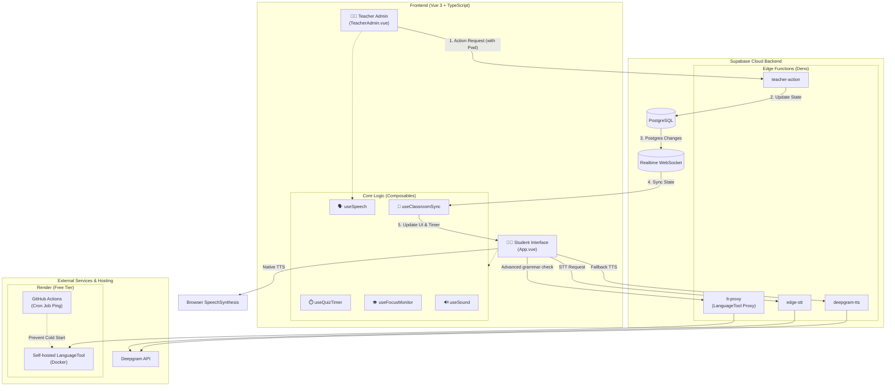
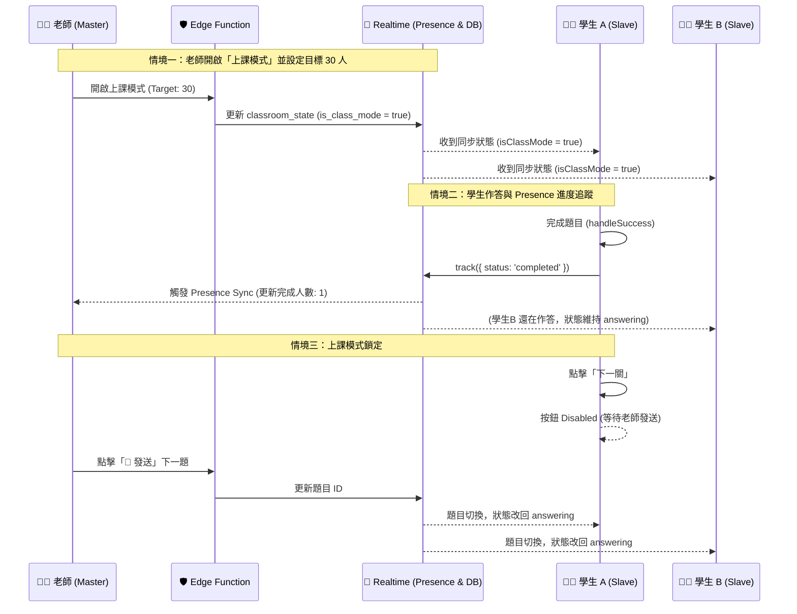
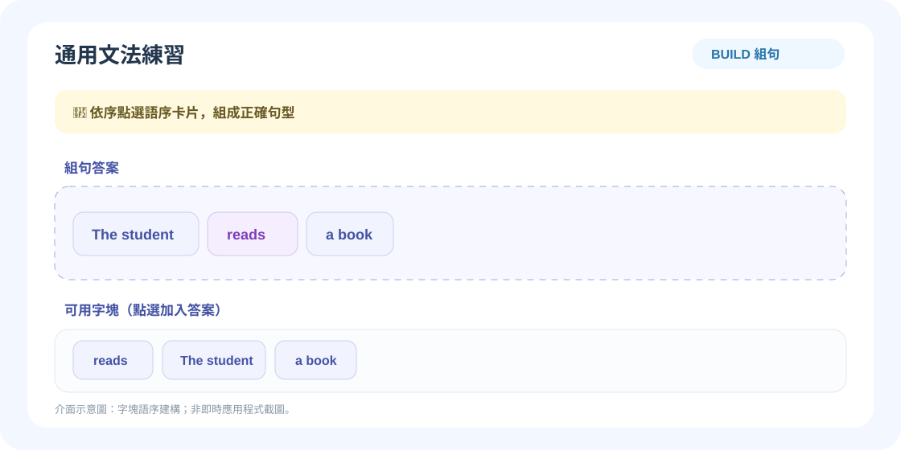
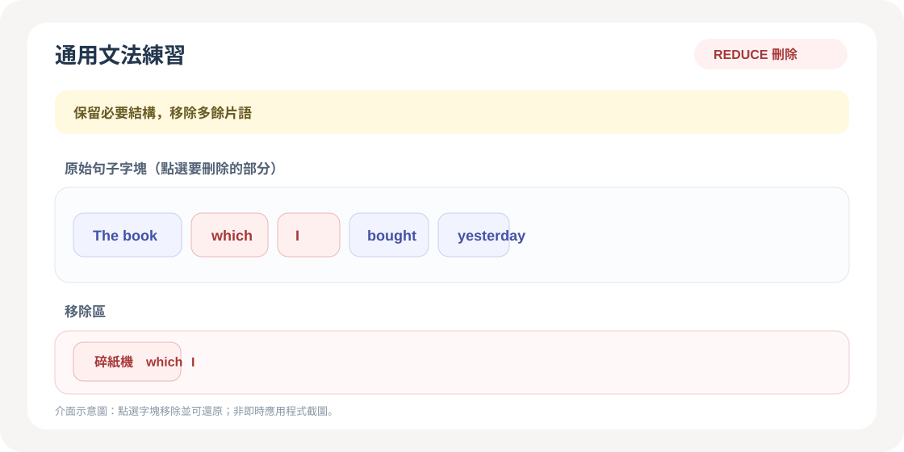
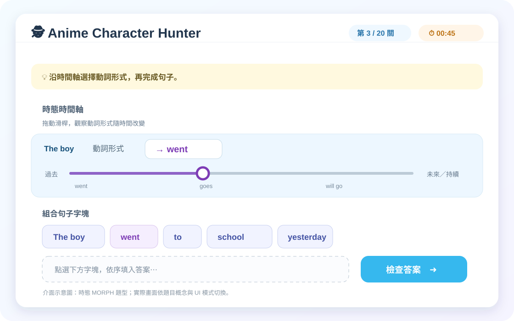
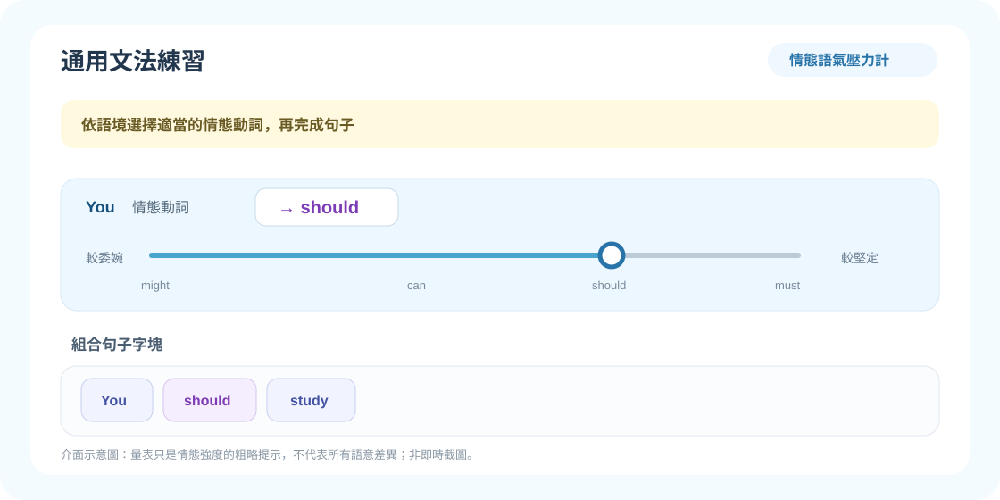

# 🕵️ SyntaxHunt (文法出題診斷系統)

**[English](README.md) | [繁體中文](README.zh-TW.md)**

一套以「認知歷程管線」為核心、專為 K-12 設計的互動式英語文法學習工具。

本專案以 **Vue 3、TypeScript、Vite 與 Supabase** 打造，教學主題為**後位修飾（關係子句與介系詞片語）**，特別針對母語干擾（中文為前位修飾、英文為後位修飾）與結構性迷思（例如 `who she` 這類多餘代名詞）。教師也可建立 `BUILD`、`REDUCE` 或 `MORPH` 通用文法題，並透過本地規則引擎及 LanguageTool 進階診斷辨識作答錯誤。

範例課程以一節 45 分鐘的**國三（115 iE5 Unit 5：*The Man Who Shook Hands with Me Is My Favorite Star*）**為設計情境。

---

## 🧠 認知歷程管線（以教學理論驅動的設計）

本工具建立在第二語言習得（SLA）理論上。範例課程透過輸入到輸出的教學流程，帶領學生完成認知循環：


1. **片語預習與測驗 (Chunk Phrase Quiz)**：學生看圖聽發音，從相似片語中選出正確的。
2. **空間建構 (Macro Drag)**：學生親手把「無文字標籤」的圖片塊拖過中線，建立英文後位修飾的空間語序感。
3. **標準題與轉換題 (Standard & Reduce)**：包含聽力輸入、聚焦形式（使用獨創的**減法垃圾桶**機制）、語音輸出與意識提升。
4. **通用文法畫布 (General Grammar Canvas)**：教師可另建 `BUILD`（組合字塊）、`REDUCE`（刪除多餘字塊）及 `MORPH`（切換字形）題型。

---

## 🏗️ 系統架構圖 (System Architecture)

本系統具備高度解耦特性，透過 **Supabase** 作為中樞，將前端 Vue 3 應用、教師端、以及外部的 AI 語音服務完美串接。



---

## 🎙️ 跨平台混合式語音架構 (Hybrid TTS & STT)

為了支援不同語音包環境，語音播放會優先使用可用的原生英文語音，並可透過 Supabase Edge Function 呼叫 Deepgram。

- **文字轉語音 (TTS)**：若有可用的原生英文語音，優先使用；否則透過 `deepgram-tts` Edge Function 呼叫 **Deepgram TTS**。Deepgram 請求失敗時不會自動改用原生語音。
- **語音轉文字 (STT)**：使用瀏覽器 `MediaRecorder` 錄音，再將錄音傳至 `edge-stt` Edge Function，由 **Deepgram STT** 轉錄。若辨識失敗，學生仍可播放自己的錄音並繼續；系統不會自動改用瀏覽器語音辨識。

---

## ⚡ 即時課堂互動時序圖 (Master-Slave, Presence & Anti-Cheat)

這張圖展示了最核心的「教師安全掌控」、「進度監控」與「防作弊」機制。



---

## ✨ 主要功能

### 給學生
- **減法垃圾桶 UI（Reduce 模式）**：學生點擊多餘的詞（如 `who`, `is`）丟進垃圾桶。視覺化看著句子縮短，親眼見證文法轉換的過程。
- **上課模式鎖定 (Class Mode Lock)**：當老師開啟上課模式時，「下一關」按鈕會被禁用，學生必須等待老師統一發送指令，確保全班節奏一致。
- **片語塊視覺化**：多字片語顯示為不可分割的藍色磚塊。
- **無標籤空間拼圖**：巨觀拖拉階段只顯示圖片，不顯示文字，避免洩題。
- **文字比對發音面板**：透過 Deepgram 辨識發音，精準畫線標示漏讀單字。

### 給老師（Teacher Admin）
- **進度監控面板 (Presence Dashboard)**：輸入目標人數，系統會即時統計「已完成人數」，並顯示高亮進度條（如 `5 / 30 人`），讓老師一眼掌握全班狀況。
- **上課模式開關 (Class Mode Toggle)**：一鍵鎖定全班進度，禁止學生偷跑。
- **漏斗式出題（Funnel Authoring）**：用 `[ ]` 框出要保留的片語，系統自動視覺化「保留」與「丟棄」的字。
- **語意控制 (Person vs. Thing)**：在出題表單中提供專屬切換鈕，讓老師明確指定先行詞是「人」或「物」。這徹底移除了過去脆弱的字串比對，確保本地規則引擎能精準判斷 `who` 與 `which` 的錯誤。
- **視覺化題目流程**：開啟全螢幕節點畫布，以連線檢視題目順序；拖曳節點到其他題目前後即可重新排序，也可選取節點後按 `Alt` + `←` / `→` 微調。完成編排後按 **完成備課**，順序會儲存至雲端並在重整後保留。
- **主從遠端控制**：老師可一鍵推送題目、強制重置計時器，或隨時點擊 `+30s` 為全班加時。

### 如何使用通用文法題

1. 開啟 **教師備課中心**，在題目編輯器選擇 **通用文法題**。
2. 選擇文法概念與互動模式。系統會依概念預設模式，也可以自行切換。
3. 輸入來源句與精確的正確答案。`REDUCE` 的來源句填完整句，答案填刪減後的句子。
4. 點選 **本地切詞**，或手動拆解句子。若要將多個字詞視為一塊，請在來源句用中括號標示，例如 `[in a blue uniform]`。在膠囊預覽中檢查並編輯拆解結果。
5. 使用 `MORPH` 時，勾選可變形字塊並輸入逗號分隔的形式，例如 `go, goes, went`。切詞使用 compromise.js 與不規則動詞 JSON 表；必要時請手動補齊或修正形式。
6. 點選 **加入題庫**。若要指定學生目前作答的題目，請在該題列按 **發送給全班**；或按 **完成備課** 儲存題庫並關閉編輯器（之後可重新開啟教師備課中心再發送）。學生以點選字磚作答：`BUILD` 組句、`REDUCE` 移除字塊、`MORPH` 選擇字形。

> **教師登入提醒：**目前前端示範版固定以 `admin123` 驗證，並將相同密碼傳給 `teacher-action`。Edge Function 未設定 `TEACHER_PASSWORD` 時預設為 `admin123`；若將 Secret 設為其他值，遠端教師操作會因密碼不一致而失敗，除非同步修改前端。這不是安全的身分驗證，請勿將此教師介面直接公開部署至正式環境。

---

## 🔬 文法規則引擎與診斷

`src/rules/grammarRules.ts` 透過註冊表執行規則，檢查關係代名詞後的重複代名詞、依先行詞判斷主謂一致、*who / which* 選擇、`REDUCE` 題的殘留字、常見主謂一致、`a/an` 選擇及 `MORPH` 字形。概念專屬規則放在 `src/rules/validators/`，由註冊表自動載入。若規則無法給出明確診斷，則以 LCS 字詞序列對齊學生答案與正解，分類遺漏、多餘、替換或語序錯誤。這些是規則式啟發判斷，不是通用英文解析器；主謂一致判斷範圍受本地動詞表限制。

| 診斷碼類別 | 範例 | 本地診斷情境 |
| :--- | :--- | :--- |
| `M:*` | `M:VERB`、`M:AUX`、`M:DET`、`M:PREP`、`M:CONJ` | 遺漏必要字詞或連接詞。 |
| `R:*` | `R:VERB:SVA`、`R:VERB:TENSE`、`R:VERB:FORM`、`R:VERB:MOOD`、`R:RELATIVE`、`R:PREP`、`R:DET`、`R:NOUN:NUM`、`R:CONJ` | 動詞形式、關係代名詞、介系詞、限定詞、名詞單複數或連接詞有誤。 |
| `U:*` | `U:PRON`、`U:VERB`、`U:RELATIVE`、`U:CONJ` | 多出不必要的代名詞、動詞、關係代名詞或連接詞。 |
| `O:*` | `O:WRONG_ORDER`、`O:INVERSION` | 字詞順序錯誤，包含倒裝句助動詞位置不正確。 |
| `UNKNOWN_ERROR` | — | 本地規則無法判定特定錯誤，接續請 LanguageTool 提供建議。 |

本地診斷保留 K-12 迷思錯誤碼及 SST 類別：`Omission`（遺漏）、`Addition`（多加）、`Misformation`（形式錯誤）或 `Misordering`（語序錯誤）。若本地規則無法分類錯誤答案，系統會透過 `lt-proxy` Supabase Edge Function 呼叫 LanguageTool，保留原生訊息、分類、Rule ID、替換建議及字元範圍，並將字元偏移映射回畫面字塊以供高亮。服務逾時（8 秒，以因應 Render 冷啟動）或失敗時會顯示中性提示，並允許學生略過到下一題。`BUILD` 與 `MORPH` 模式也可在尚未填滿所有字塊前檢查目前答案。

教師建立通用文法題時可選擇概念與互動模式。`autoChunk(sentence, concept)` 使用 compromise.js 確定性切詞與動詞辨識，優先查詢不規則動詞表，並將中括號片語保留為明確字塊；不呼叫 LLM。MORPH 選項以字串陣列儲存，`current_index` 表示初始選取形式，並保留 `morph_options` 舊欄位相容。新概念會路由至時間軸、情態語氣計、碎紙機或磁吸卡槽；未設定概念的舊題仍使用既有畫布。

### 2026-11-5:

*   **上下文拼接 (Context Stitching)**：送出語言檢查時，系統會自動將 `contextCloze` 的前綴（prefix）與後綴（suffix）與學生的作答組合，還原成完整的句子，避免 LanguageTool 誤判（如首字大寫錯誤）。
*   **精準偏移映射 (Offset Mapping)**：LanguageTool 回傳的字元偏移量（offset）會先扣除前綴長度，再透過 `mapOffsetToChunkIndex` 精準映射回學生的字塊陣列，確保紅字提示標示在正確的字塊上。

### RuleRegistry 如何串起出題、遊戲介面與診斷

RuleRegistry 是**本地診斷規則的插件註冊點**，不是出題表單或遊戲介面的路由器：

1. **教師出題：**在 Teacher Admin 選擇文法概念與 `BUILD`、`REDUCE` 或 `MORPH`，輸入句子和答案，再用本地 `autoChunk` 切詞（也可手動編輯字塊及變形選項）。題目會儲存所選概念與模式。`autoChunk` 不會查詢 RuleRegistry。
2. **遊戲介面：**`GrammarCanvas.vue` 依題目儲存的 `concept` 與 `ui_mode` 選擇畫布，並不查詢已註冊規則。`defaultUiModeForConcept` 提供概念預設模式，教師仍可覆寫。現行路由如下：

   | 題目設定 | 學生互動介面 |
   | :--- | :--- |
   | `MODAL_VERB` | 情態語氣壓力計 |
   | `REDUCE` | 碎紙機式刪減 |
   | `MORPH` + 時態、主謂一致、假設語氣或條件句 | 時態時間軸 |
   | `BUILD` | 磁吸式句子卡槽 |
   | 沒有概念或未符合以上組合 | 舊版畫布 |

   下方均為**介面示意圖，並非即時應用程式截圖**。學生實際看到的畫布依上表路由；一般字磚以點選操作而非拖曳，`REDUCE` 保留的字磚可使用左右箭頭調整詞序。

   | `BUILD` — 組合句子字塊 | `REDUCE` — 移除多餘字塊 |
   | :---: | :---: |
   |  |  |

   | `MORPH` — 選擇時態或動詞形式 | `MODAL_VERB` — 選擇情態強度 |
   | :---: | :---: |
   |  |  |
3. **作答診斷：**學生送出答案後，`diagnoseGrammar` 執行通用規則，以及符合該題概念的專屬規則。`grammarRules.ts` 會 eager-load `src/rules/validators/*.ts`；每個插件以唯一 ID、驗證函式及可選的概念清單呼叫 `registerGrammarRule`。例如連接詞規則套用於子句概念、倒裝規則套用於問句／倒裝概念、情態動詞形式規則套用於 `MODAL_VERB`。明確的本地診斷訊號會沿用既有迷思回饋與紀錄流程；若本地規則無法分類，則呼叫 LanguageTool，並保留其原生診斷資料。

因此，新增 validator 只會擴充本地診斷，不會自動新增教師表單選項或視覺互動；如需新概念或新畫布，還需視需求更新型別／概念選項及介面路由。新增規則時，將檔案放在 `src/rules/validators/` 並註冊唯一 ID。

### 現有 UI 足以涵蓋 `Grammar_Scope.md` 嗎？

教師出題表單已提供範圍內列出的所有文法概念，但這**不代表每種文法差異都有完整的遊戲建模或診斷能力**。目前對照如下：

| 文法範圍 | 現有互動 | 覆蓋情況與限制 |
| :--- | :--- | :--- |
| 句子單位、S/V/O/C、五大句型 | `BUILD` | 可組合指定正解，但不會標示文法角色，也沒有各句型專屬題目機制。 |
| 主謂一致、時態與狀態 | `MORPH` 或 `BUILD` | 可設定字形選項並依正解判斷；自動產生形式的字彙有限，時間軸也未完整建模所有時態／狀態組合。 |
| 問句與倒裝 | `BUILD` | 可組合問句／倒裝句；本地倒裝診斷是啟發式規則，並非通用問句解析器。 |
| 連接詞、名詞／形容詞／副詞子句 | `BUILD`／`REDUCE` | 可組合或刪減教師設定的字塊；確定性切詞不會辨識子句邊界或文法角色，教師可用中括號指定片語並編輯生成的字塊。 |
| 假設語氣與條件句 | `MORPH`／`BUILD` | 可練習教師提供的形式與語序，但沒有專門呈現兩個子句關係的條件句互動；本地語氣診斷僅涵蓋少數形式。 |
| 情態動詞（目前範圍文件之外的額外概念） | 情態強度計加 `BUILD` | 強度軸僅為粗略提示，無法涵蓋情態動詞依語境而變的所有語意；本地檢查主要針對情態動詞後接原形。 |

**建議：**若要開始練習這些範圍，不需要立刻新增頂層遊戲題型；`BUILD`、`REDUCE`、`MORPH` 已涵蓋組合、移除與變形三種基本操作。但目前也不足以宣稱已完整支援 K–12 文法。建議先在既有模式補強 S/V/O/C 與子句結構鷹架、豐富時態／狀態選項、增加雙子句條件句提示，並擴充診斷規則。只有當某概念無法用字塊組合、刪減或形式選擇表達時，才需要新增獨立遊戲題型。

### 實作與部署進度（2026-11-05）

自適應畫布、舊題轉接器、compromise.js 本地切詞、本地規則引擎及 LanguageTool 診斷鏈路均已實作。錯誤答案若沒有明確的本地診斷，瀏覽器會呼叫 Supabase `lt-proxy` Edge Function，再由代理轉送文字至已設定的 Render  LanguageTool，並回傳原生診斷供畫面顯示與紀錄。代理已處理瀏覽器 `POST` 預檢；若未設定 `LANGUAGETOOL_URL`，會明確回傳設定錯誤。舊題載入畫布時才轉接，不會改寫 `questions` 資料表。

教師密碼驗證成功後，系統會自動透過相同代理送出一段有效短句，預熱 LanguageTool 服務。此請求不會建立學習紀錄；即使預熱失敗，也不會阻擋教師進入系統。

### 自架 LanguageTool (Render)
1. 在 Render 建立一個新的 Web Service，選擇 **Deploy an existing image**，填入 `docker.io/erikvl87/languagetool:latest`。
2. 設定環境變數以防 OOM：
   - `Java_Xms=128m`
   - `Java_Xmx=320m`
   - `JAVA_TOOL_OPTIONS=-XX:MaxRAMPercentage=60.0 -XX:+UseSerialGC -XX:MaxMetaspaceSize=128m`
3. 部署成功後，將 Render 提供的 URL（加上 `/v2/check`）設定到 Supabase Secrets：
   ```bash
   npx supabase secrets set LANGUAGETOOL_URL=https://your-render-url.onrender.com/v2/check
   npx supabase functions deploy lt-proxy
   ```

---

## 🛠️ 技術棧與工程

- **前端**：Vue 3（Composition API）+ Vite + TypeScript
- **本地 NLP**：compromise.js + `english-verbs-irregular`
- **診斷引擎**：Local Rule Registry + LCS algorithm + LanguageTool (Deep Semantic Check)
- **後端與資料庫**：Supabase（PostgreSQL、Edge Functions、Realtime Presence）
- **基礎設施**: Render (Docker / LanguageTool) + GitHub Actions (Keep-Alive)
- **語音 (TTS & STT)**：可用的原生 `SpeechSynthesis` 語音；Deepgram TTS／STT 透過 Edge Functions 呼叫
- **拖曳**：原生 Pointer Events 與瀏覽器 HTML Drag and Drop API

### 🛡️ 基礎設施與防冷啟動 (Infrastructure & Keep-Alive)
為達成零營運成本，本系統將 LanguageTool 部署於 Render 免費方案，並透過 GitHub Actions (`keep-alive.yml`) 每 10 分鐘發送一次 `POST` 請求進行保活。此機制確保課堂上的文法診斷請求不會遭遇 30-60 秒的冷啟動延遲

---

## 🚀 快速開始

### 環境設定
建立 `.env.local` 檔案：
```env
VITE_SUPABASE_URL=your_supabase_project_url
VITE_SUPABASE_ANON_KEY=your_supabase_anon_key
```

### Supabase 設定
1. 請先建立應用程式使用的基礎資料表；此程式庫未包含建立這些資料表的遷移：
   - `questions`：`id`、`data`、`created_at`。
   - `learning_logs`：`id`、`student_name`、`question_id`、`error_code`、`created_at`。資料表建好後，請套用遷移新增 `sst`、`status`、`diagnosis`、`source`、`category`、`rule_id` 等診斷欄位。
   - `classroom_state`：`id`、`current_question_id`、`timer_end_time`、`is_class_mode`、`target_count`、`updated_at`。新增 `id = 'current_state'` 的資料列，並為此表開啟 Realtime。

   請依部署需求設定前端 Supabase anon key 所需的資料表存取政策。前端會直接讀寫題庫與學習紀錄；教師課堂狀態則透過 `teacher-action` Edge Function 更新。
2. 套用資料庫遷移並部署 Edge Functions：
   ```bash
   npx supabase link --project-ref <你的 Supabase project ref>
   npx supabase db push
   npx supabase functions deploy deepgram-tts
   npx supabase functions deploy edge-stt
   npx supabase functions deploy teacher-action
   npx supabase functions deploy lt-proxy
   ```
3. 設定服務所需的 Secrets：
   ```bash
   npx supabase secrets set DEEPGRAM_API_KEY=your_deepgram_key
   npx supabase secrets set LANGUAGETOOL_URL=https://lt-proxy-xxx.run.app/v2/check
   ```
   `LANGUAGETOOL_URL` 僅在啟用 LanguageTool 診斷時需要。示範版請勿設定 `TEACHER_PASSWORD`，以使用固定的 `admin123`；若設定其他值，會與前端密碼不符。

若寫入 `learning_logs` 出現 HTTP 400，請先檢查瀏覽器 console 的 Supabase `code` 與 `message`，並確認 migration 已套用到目前前端連線的同一個 Supabase 專案。若錯誤指出欄位不在 schema cache，先確認資料表已有該欄位；若欄位已存在，再於 Supabase SQL Editor 執行 `notify pgrst, 'reload schema';` 更新 API schema cache。

### 開發與測試
```bash
npm install
npm run dev
npm test
```