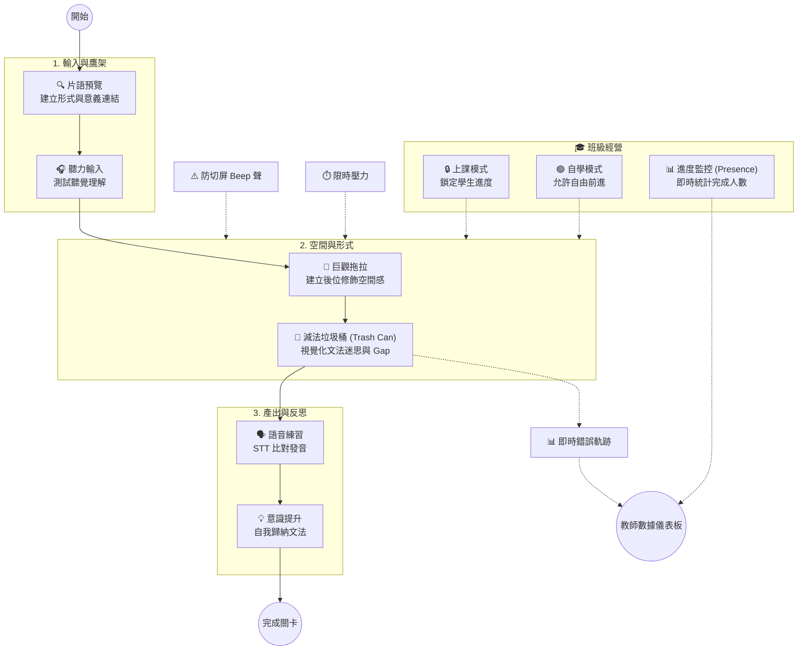
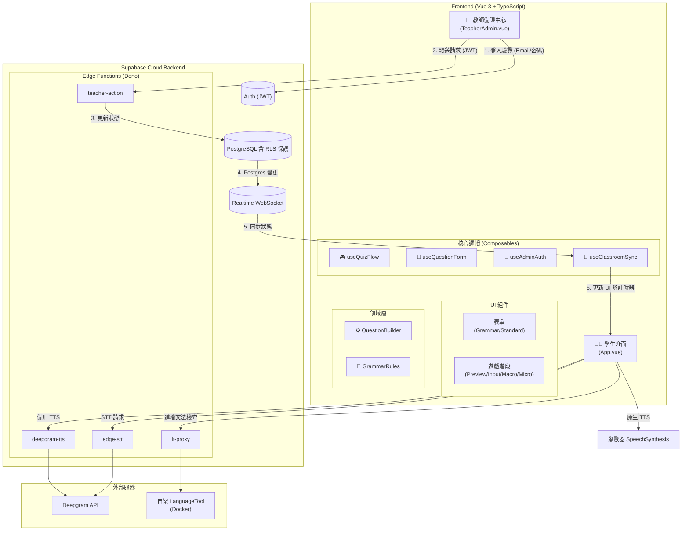
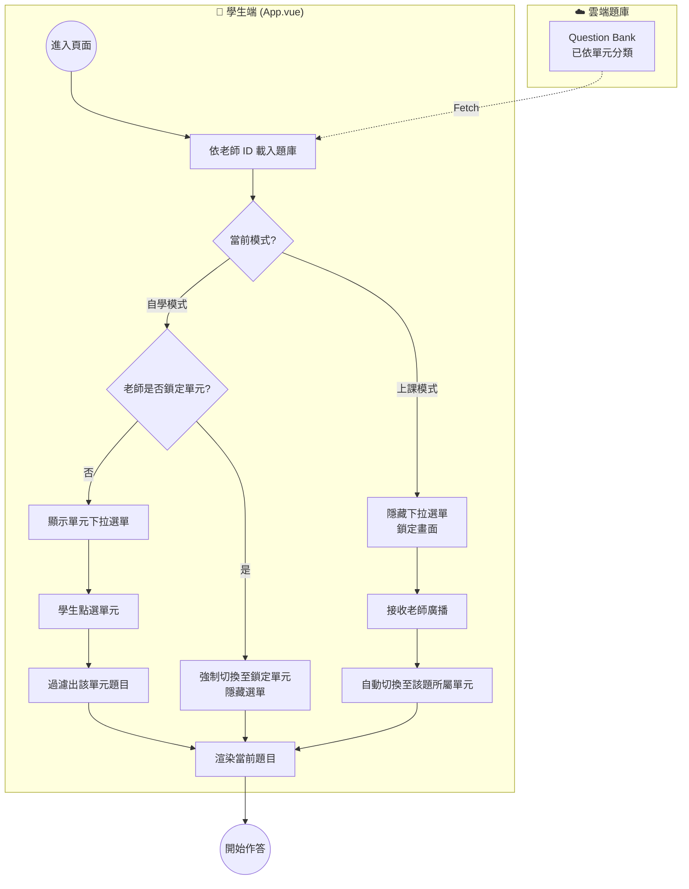
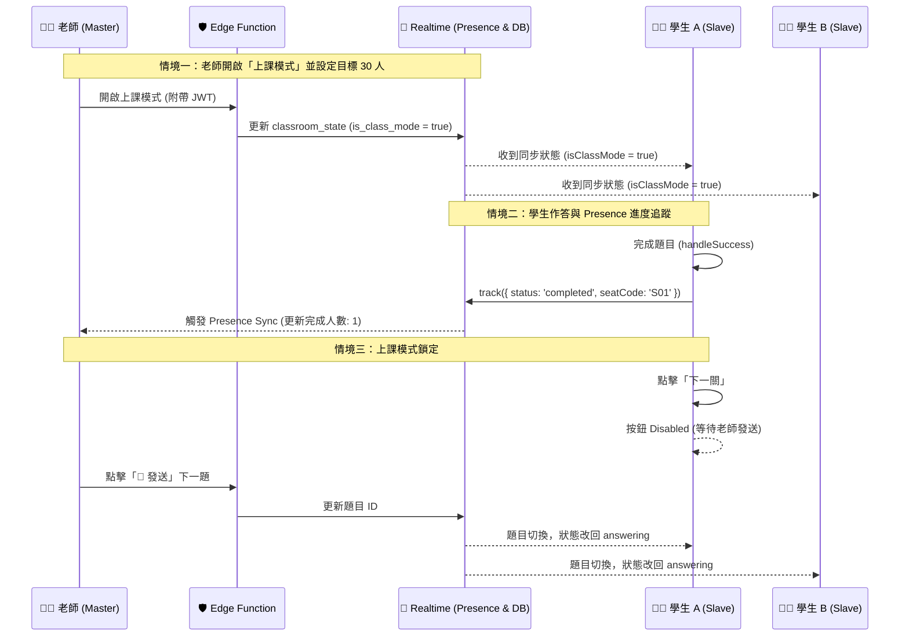

# 🕵️ SyntaxHunt (文法出題診斷系統)

**[English](README.md) | [繁體中文](README.zh-TW.md)**

一套以「認知歷程管線」為核心、專為 K-12 設計的互動式英語文法學習工具。

本專案以 **Vue 3、TypeScript、Vite 與 Supabase** 打造，教學主題為**後位修飾（關係子句與介系詞片語）**，特別針對母語干擾與結構性迷思。教師也可建立 `BUILD`、`REDUCE` 或 `MORPH` 通用文法題，並透過本地規則引擎及 LanguageTool 進階診斷辨識作答錯誤。

範例課程以一節 45 分鐘的**國三（115 iE5 Unit 5：*The Man Who Shook Hands with Me Is My Favorite Star*）**為設計情境。

---

## 🧠 認知歷程管線（以教學理論驅動的設計）

本工具建立在第二語言習得（SLA）理論上。範例課程透過輸入到輸出的教學流程，帶領學生完成認知循環：



---

## 🏗️ 系統架構圖 (System Architecture)

本系統具備高度解耦特性，採用 **領域驅動設計 (DDD)** 與 **整潔架構 (Clean Architecture)**，透過 **Supabase** 作為中樞，將前端 Vue 3 應用、教師端、以及外部的 AI 語音服務完美串接。



### 題目路由資料流 (Student Question Routing)

這張圖展示了系統如何根據「班級模式」，決定將哪些題目渲染給學生。



---

## 🔒 多租戶與安全性 (教師資料隔離)

本系統嚴格實作多租戶架構，確保每位教師只能看到並修改自己的題庫與班級狀態。

- **Supabase Auth**：教師透過 Email 與密碼登入 (`signInWithPassword`)。
- **資料庫 Schema**：`questions`、`learning_logs`、`classroom_state` 皆包含 `teacher_id UUID REFERENCES auth.users(id) DEFAULT auth.uid()` 欄位。
- **資料列級別安全 (RLS)**：
  - **教師**：只能對 `auth.uid() = teacher_id` 的資料進行 `SELECT`、`INSERT`、`UPDATE`、`DELETE`。
  - **學生**：**不會**直接存取 `questions` 表。學生端題庫來自 `localStorage` 或預設題目，並透過 `room_code` 加入老師的 Realtime 頻道。
- **座號 (Seat Codes)**：學生隨機分配 `S01`–`S30` 的座號並存入 `sessionStorage`，透過 `trackPresence(seatCode)` 傳送給老師端顯示。
- **頻道隔離**：Realtime 頻道嚴格命名為 `classroom_sync_${teacherId}`，防止跨租戶資料外洩。

---

## ⚡ 即時課堂互動時序圖 (Master-Slave, Presence & Anti-Cheat)

這張圖展示了最核心的「教師安全掌控」、「進度監控」與「防作弊」機制。



---

## ✨ 主要功能

### 給學生
- **減法垃圾桶 UI（Reduce 模式）**：學生點擊多餘的詞丟進垃圾桶，視覺化看著句子縮短。
- **上課模式鎖定 (Class Mode Lock)**：當老師開啟上課模式時，「下一關」按鈕會被禁用。
- **片語塊視覺化**：多字片語顯示為不可分割的藍色磚塊。
- **無標籤空間拼圖**：巨觀拖拉階段只顯示圖片，不顯示文字，避免洩題。
- **文字比對發音面板**：透過 Deepgram 辨識發音，精準畫線標示漏讀單字。
- **單元選擇器與遠端鎖定**：在自由進度模式下，學生可透過下拉選單切換單元。但若老師發布了「鎖定單元」，選單會自動隱藏並替換為鎖定提示，強制學生專注於當前單元。

### 給老師（Teacher Admin）
- **進度監控面板 (Presence Dashboard)**：輸入目標人數，系統會即時統計「已完成人數」，並顯示高亮進度條。
- **上課模式開關 (Class Mode Toggle)**：一鍵鎖定全班進度，禁止學生偷跑。
- **漏斗式出題（Funnel Authoring）**：用 `[ ]` 框出要保留的片語，系統自動視覺化「保留」與「丟棄」的字。
- **語意控制 (Person vs. Thing)**：明確指定先行詞是「人」或「物」，確保本地規則引擎能精準判斷 `who` 與 `which`。
- **視覺化題目流程與單元資料夾**：開啟全螢幕節點畫布，以連線檢視及調整題目順序。
- **主從遠端控制**：老師可一鍵推送題目、強制重置計時器，或隨時點擊 `+30s` 為全班加時。
- **單元級別鎖定 (Unit Locking)**：老師可在班級控制面板選擇特定單元並發布，強制學生端只能看到該單元的題目，隱藏切換選單，防止學生偷跑或分心。
- **一鍵掃碼加入 (QR Code)**：老師可在班級控制面板點擊生成全螢幕 QR Code，學生用手機或平板掃描即可自動帶入 `?room=XXXX` 參數並加入專屬班級頻道，省去手動輸入代碼的麻煩。

### 如何使用通用文法題

1. 開啟 **教師備課中心**，在題目編輯器選擇 **通用文法題**。
2. 先選課綱章節，再選具體文法考點。
3. 輸入來源句與精確的正確答案。
4. 點選 **本地切詞**，或手動拆解句子。
5. 使用 `MORPH` 考點時，只勾選一個可變形目標字塊，並輸入逗號分隔的形式。
6. 點選 **加入題庫**。若要指定學生目前作答的題目，請在該題列按 **發送給全班**。

> **教師登入提醒：**教師登入已全面改為 Supabase Auth（`signInWithPassword`，Email + 密碼）。現在您可以直接在登入彈窗中點擊「**點此註冊**」來建立新的教師帳號，或者到 Supabase 後台手動新增。

---

## 🛠️ 技術棧與工程

- **前端**：Vue 3（Composition API）+ Vite + TypeScript
- **狀態管理**：Vue Composables (`useQuizFlow`, `useQuestionForm`, `useClassroomSync`)
- **本地 NLP**：compromise.js + `english-verbs-irregular`
- **診斷引擎**：Local Rule Registry + LCS algorithm + LanguageTool (Deep Semantic Check)
- **後端與資料庫**：Supabase（PostgreSQL、Edge Functions、Realtime Presence、Auth、RLS）
- **基礎設施**：Render (Docker / LanguageTool) + GitHub Actions (Keep-Alive)
- **語音 (TTS & STT)**：可用的原生 `SpeechSynthesis` 語音；Deepgram TTS／STT 透過 Edge Functions 呼叫
- **QR Code 產生**：`qrcode.vue`

---

## 🚀 快速開始

### 環境設定
建立 `.env.local` 檔案：
```env
VITE_SUPABASE_URL=your_supabase_project_url
VITE_SUPABASE_ANON_KEY=your_supabase_anon_key
```

### Supabase 設定
1. 建立基礎資料表 (`questions`, `learning_logs`, `classroom_state`)。
2. 套用最新的多租戶與 RLS 遷移腳本：
   ```bash
   npx supabase db push
   ```
3. 部署 Edge Functions：
   ```bash
   npx supabase functions deploy deepgram-tts
   npx supabase functions deploy edge-stt
   npx supabase functions deploy teacher-action
   npx supabase functions deploy lt-proxy
   ```
4. 到 **Supabase Dashboard -> Authentication -> Users** 建立一組教師帳號。

### 開發與測試
```bash
npm install
npm run dev
npm test
```