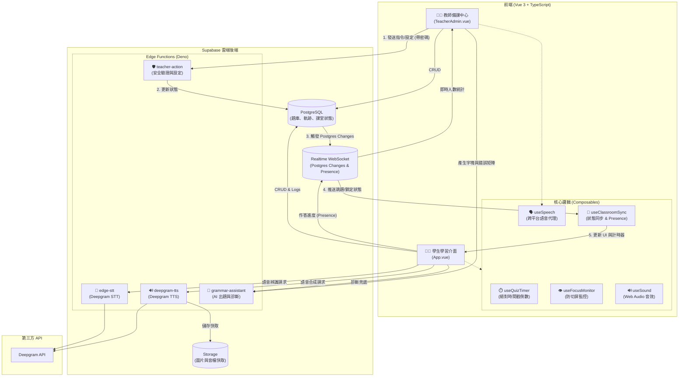
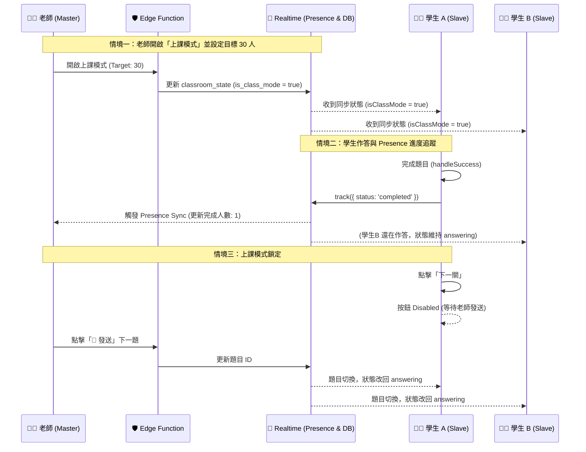

# 🕵️ Anime Character Hunter Lite（動漫角色大搜尋）

**[English](README.md) | [繁體中文](README.zh-TW.md)**

一套以「認知歷程管線」為核心、專為 K-12 設計的互動式英語文法學習工具。

本專案以 **Vue 3、TypeScript、Vite 與 Supabase** 打造，教學主題為**後位修飾（關係子句與介系詞片語）**，特別針對母語干擾（中文為前位修飾、英文為後位修飾）與結構性迷思（例如 `who she` 這類多餘代名詞）。教師也可建立 `BUILD`、`REDUCE` 或 `MORPH` 通用文法題，並透過本地規則引擎、診斷快取及 AI 兜底辨識作答錯誤。

範例課程以一節 45 分鐘的**國三（115 iE5 Unit 5：*The Man Who Shook Hands with Me Is My Favorite Star*）**為設計情境。

---

## 🧠 認知歷程管線（以教學理論驅動的設計）

本工具建立在第二語言習得（SLA）理論上。範例課程透過輸入到輸出的教學流程，帶領學生完成認知循環：


1. **片語預習與測驗 (Chunk Phrase Quiz)**：學生看圖聽發音，從相似片語中選出正確的。
2. **空間建構 (Macro Drag)**：學生親手把「無文字標籤」的圖片塊拖過中線，建立英文後位修飾的空間語序感。
3. **標準題與轉換題 (Standard & Reduce)**：包含聽力輸入、聚焦形式（使用獨創的**減法垃圾桶**機制）、語音輸出與意識提升。
4. **通用文法畫布 (General Grammar Canvas)**：教師可另建 `BUILD`（組合字塊）、`REDUCE`（刪除多餘字塊）及 `MORPH`（切換字形）題型。

---

## 🏗️ 系統架構圖 (System Architecture)

本系統具備高度解耦特性，透過 **Supabase** 作為中樞，將前端 Vue 3 應用、教師端、以及外部的 AI 語音服務完美串接。



---

## 🎙️ 跨平台混合式語音架構 (Hybrid TTS & STT)

為了確保在 iPad、一般電腦、以及**沒有語音包的智慧白板**上都能 100% 穩定運作，本專案實作了基於 Supabase Edge Functions 的降級備援機制。

- **文字轉語音 (TTS)**：優先偵測系統原生語音包。若無語音包（如 Windows 白板），則自動呼叫 `deepgram-tts` 代理。
- **語音轉文字 (STT)**：完全繞過瀏覽器 Web Speech API 的限制（如 Safari 的 `service-not-allowed`），將錄音檔傳送至 `edge-stt` 代理，交由 **Deepgram** 進行精準辨識。

---

## ⚡ 即時課堂互動時序圖 (Master-Slave, Presence & Anti-Cheat)

這張圖展示了最核心的「教師安全掌控」、「進度監控」與「防作弊」機制。



---

## ✨ 主要功能

### 給學生
- **減法垃圾桶 UI（Reduce 模式）**：學生點擊多餘的詞（如 `who`, `is`）丟進垃圾桶。視覺化看著句子縮短，親眼見證文法轉換的過程。
- **上課模式鎖定 (Class Mode Lock)**：當老師開啟上課模式時，「下一關」按鈕會被禁用，學生必須等待老師統一發送指令，確保全班節奏一致。
- **片語塊視覺化**：多字片語顯示為不可分割的藍色磚塊。
- **無標籤空間拼圖**：巨觀拖拉階段只顯示圖片，不顯示文字，避免洩題。
- **文字比對發音面板**：透過 Deepgram 辨識發音，精準畫線標示漏讀單字。

### 給老師（Teacher Admin）
- **進度監控面板 (Presence Dashboard)**：輸入目標人數，系統會即時統計「已完成人數」，並顯示高亮進度條（如 `5 / 30 人`），讓老師一眼掌握全班狀況。
- **上課模式開關 (Class Mode Toggle)**：一鍵鎖定全班進度，禁止學生偷跑。
- **漏斗式出題（Funnel Authoring）**：用 `[ ]` 框出要保留的片語，系統自動視覺化「保留」與「丟棄」的字。
- **主從遠端控制**：老師可一鍵推送題目、強制重置計時器，或隨時點擊 `+30s` 為全班加時。

---

## 🔬 文法規則引擎與診斷

`src/rules/grammarRules.ts` 以確定性本地規則檢查關係代名詞後的重複代名詞、依先行詞判斷主謂一致、*who / which* 選擇、`REDUCE` 題的殘留字、常見主謂一致、`a/an` 選擇及 `MORPH` 字形。若本地規則無法給出明確診斷，則以 LCS 字詞序列對齊學生答案與正解，分類遺漏、多餘、替換或語序錯誤。這些是規則式啟發判斷，不是通用英文解析器；主謂一致判斷範圍受本地動詞表限制。

| 診斷碼類別 | 範例 | 本地診斷情境 |
| :--- | :--- | :--- |
| `M:*` | `M:VERB`、`M:AUX`、`M:DET`、`M:PREP` | 遺漏必要動詞、助動詞、限定詞或介系詞。 |
| `R:*` | `R:VERB:SVA`、`R:VERB:TENSE`、`R:RELATIVE`、`R:PREP`、`R:DET`、`R:NOUN:NUM` | 動詞形式、關係代名詞、介系詞、限定詞或名詞單複數有誤。 |
| `U:*` | `U:PRON`、`U:VERB`、`U:RELATIVE` | 多出不必要的代名詞、動詞或關係代名詞。 |
| `O:WRONG_ORDER` | — | 字詞相同，但排列順序不同。 |
| `UNKNOWN_ERROR` | — | 本地規則無法判定特定錯誤，接續查詢預建診斷或 AI 兜底。 |

每筆診斷也會標記 SST 類別：`Omission`（遺漏）、`Addition`（多加）、`Misformation`（形式錯誤）或 `Misordering`（語序錯誤）。系統優先使用明確的本地診斷；否則依序查詢 `diagnosis_cache`，再透過 `grammar-assistant` Edge Function 呼叫 Gemini。遠端診斷最多等待 3 秒，若失敗會提示學生自行對照答案。教師可用 AI 產生字塊、編輯變形選項及預建常見錯誤診斷；學情看板依四種 SST 類別統計。

啟用雲端 AI 與診斷快取前，先套用資料庫遷移、部署函式並設定 Gemini 金鑰：

```bash
npx supabase db push
npx supabase functions deploy grammar-assistant
npx supabase secrets set GEMINI_API_KEY=your_gemini_api_key
```

Gemini 金鑰只設定在 Supabase Edge Function Secrets，不要放入 `.env.local` 或前端程式碼。未部署函式或未設定金鑰時，AI 拆解/兜底診斷會顯示明確錯誤；本地診斷仍可使用。

---

## 🛠️ 技術棧與工程

- **前端**：Vue 3（Composition API）+ Vite + TypeScript
- **後端與資料庫**：Supabase（PostgreSQL、Storage、Edge Functions、Realtime Presence）
- **語音 (TTS & STT)**：Deepgram API（透過 Edge Function 代理）+ Web Speech API 降級備援
- **拖曳**：原生 Pointer Events 與 `vue-draggable-plus`

---

## 🚀 快速開始

### 環境設定
建立 `.env.local` 檔案：
```env
VITE_SUPABASE_URL=your_supabase_project_url
VITE_SUPABASE_ANON_KEY=your_supabase_anon_key
```

### Supabase 設定
1. 建立名為 `tts-audio` 的 **Public** Storage bucket。
2. 建立 `classroom_state` 資料表並開啟 Realtime (`supabase_realtime`)。
3. 套用資料庫遷移並部署 Edge Functions：
   ```bash
   npx supabase db push
   npx supabase functions deploy deepgram-tts
   npx supabase functions deploy edge-stt
   npx supabase functions deploy teacher-action
   npx supabase functions deploy grammar-assistant
   ```
4. 設定 Secrets（API 金鑰與教師密碼）：
   ```bash
   npx supabase secrets set DEEPGRAM_API_KEY=your_deepgram_key
   npx supabase secrets set TEACHER_PASSWORD=your_teacher_password
   npx supabase secrets set GEMINI_API_KEY=your_gemini_api_key
   ```

### 開發與測試
```bash
npm install
npm run dev
npm test
```